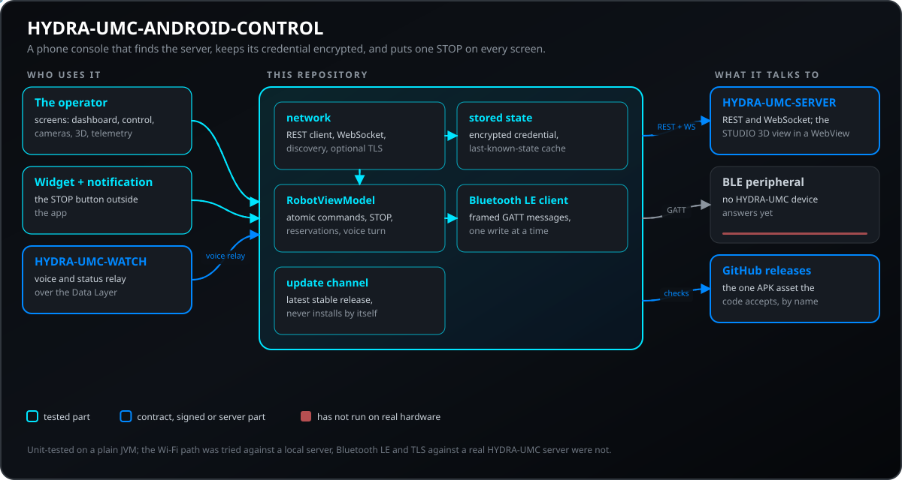
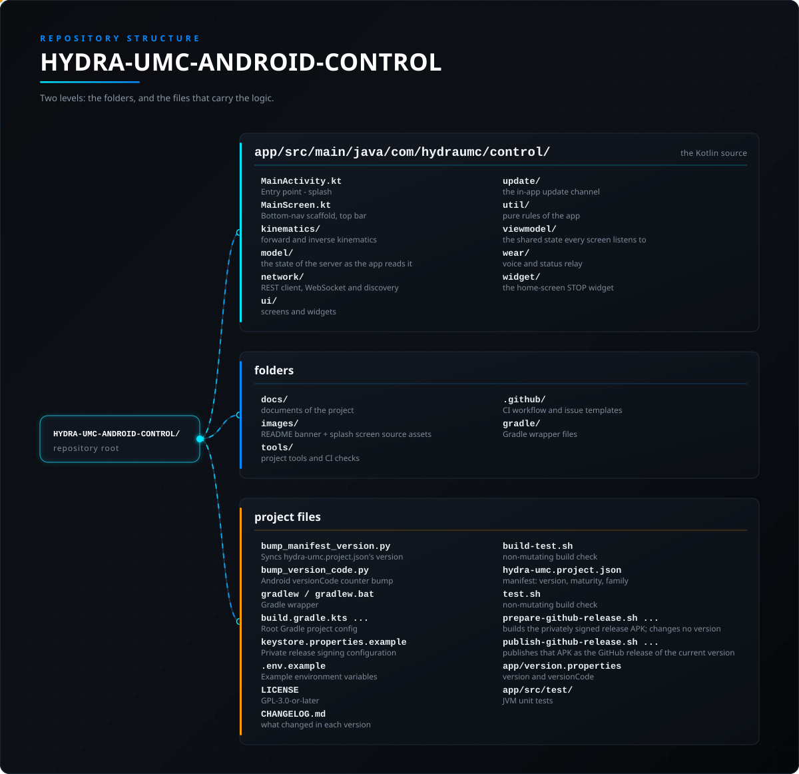

<!-- =============================================================================
HYDRA-UMC-ANDROID-CONTROL - Android operator console for a HYDRA-UMC server: control, cameras, 3D view and a global STOP
Copyright (C) JuanenRac (Electro Hobby 3D) <electrohobby3d@gmail.com>
GPL-3.0-or-later - see LICENSE
============================================================================= -->

<p align="center">
  
</p>

# 📱 HYDRA-UMC-ANDROID-CONTROL

<p align="center"><a href="README.md">🇺🇸 English</a> | <a href="README_spa.md">🇪🇸 Español</a> | 🇫🇷 <b>Français</b> | <a href="README_ita.md">🇮🇹 Italiano</a> | <a href="README_deu.md">🇩🇪 Deutsch</a> | <a href="README_zho.md">🇨🇳 简体中文</a> | <a href="README_jpn.md">🇯🇵 日本語</a> | <a href="README_por.md">🇵🇹 Português</a></p>

### Vos robots HYDRA-UMC dans la poche : trouvez le serveur, déplacez et surveillez les robots, et arrêtez tout avec un bouton rouge.

<p align="center">
  
  
  
  
  
  
  
</p>

---

Une application Android native (Kotlin + Jetpack Compose) qui contrôle un robot sur la plateforme [HYDRA-UMC](https://github.com/JuanenRac/HYDRA-UMC) via Wi-Fi ou Bluetooth, en parlant exactement le même contrat [`REMOTE_API.md`](https://github.com/JuanenRac/HYDRA-UMC-SERVER/blob/main/docs/REMOTE_API.md) que celui utilisé par [HYDRA-UMC SUITE](https://github.com/JuanenRac/HYDRA-UMC-SUITE) - découverte, lecture/écriture de l'état complet, et synchronisation live par WebSocket avec un backend [HYDRA-UMC-SERVER](https://github.com/JuanenRac/HYDRA-UMC-SERVER) en cours d'exécution (le même que celui utilisé par le tableau de bord web de [HYDRA-UMC STUDIO](https://github.com/JuanenRac/HYDRA-UMC-STUDIO)). Contrepartie Android directe de [HYDRA-UMC-IOS-CONTROL](https://github.com/JuanenRac/HYDRA-UMC-IOS-CONTROL). Voir [`docs/ARCHITECTURE.md`](docs/ARCHITECTURE.md) pour la conception complète.

> **Vérification d'honnêteté - ce qui fonctionne réellement aujourd'hui :** la logique métier centrale - la cinématique Parol6 (`kinematics/Parol6Kinematics.kt`), le contrat d'état de l'arbre de configuration (`model/HydraState.kt`), l'envoi de commandes atomiques et le relais vocal (`viewmodel/RobotViewModel.kt`), la reconnexion WebSocket (`network/HydraWebSocket.kt`), le parsing des frames MJPEG (`ui/MjpegPlayer.kt`), le canal de mise à jour interne (`update/GitHubReleaseUpdater.kt`, `ReleaseMetadataParser.kt`, `SemanticVersion.kt`), et la gestion des requêtes du relais vocal Wear (`wear/BoundedRequestScope.kt`, `WatchCompanionProtocol.kt`) sont réels et couverts par 303 tests unitaires JVM/Robolectric qui passent (`./gradlew testDebugUnitTest`). Ce que ces tests ne peuvent structurellement pas atteindre - et ce que cet environnement de développement uniquement Windows n'a pas d'appareil Android physique pour vérifier - c'est le vrai `EncryptedSharedPreferences` adossé au Keystore de `network/AuthPrefs.kt`, l'invite empreinte/visage d'`androidx.biometric`, le transport Bluetooth GATT de `network/HydraBleClient.kt`, et le chemin `ImageDecoder` matériel en API 28+ dans `MjpegStreamParser` : du code réel et compilé qui n'a pas été revérifié sur du matériel depuis son écriture. Le lancement/login de base *a* été confirmé en direct sur un appareil réel pour des versions antérieures (voir les entrées `v0.3.2`/`v0.3.3` de `CHANGELOG.md`), mais cela précède le Bluetooth, la biométrie et le chemin de décodage matériel. Voir `CHANGELOG.md` pour ce qui a exactement été livré, y compris ses propres notes par entrée sur ce qui reste non vérifié sur matériel.

> **État de la sûreté et de la cybersécurité :** cet écosystème n'est pas un système de sécurité certifié. Il n'existe pas encore de chaîne d'E-STOP matérielle, ni de limites ou de verrouillages imposés par le firmware, ni de commande de mouvement vérifiée ; les images de firmware sont contrôlées par CRC-32 et une signature Ed25519, et une compilation de version refuse les clés de développement publiées (les têtes d'outil et les cartes d'extension derrière le relais utilisent encore les chargeurs d'URTC, qui prennent un HMAC-SHA256 à clé partagée au lieu d'une signature) ; TLS et TLS mutuel sont optionnels et désactivés par défaut ; aucune carte propre n'a encore été assemblée ni testée. Lisez la [base de sécurité](https://github.com/JuanenRac/HYDRA-UMC-DOCS/blob/main/docs/SECURITY_BASELINE.md) et le [modèle de menaces](https://github.com/JuanenRac/HYDRA-UMC-DOCS/blob/main/docs/THREAT_MODEL.md) avant de vous fier à une affirmation d'ici pour la sécurité d'une personne.

---

## 📋 En un coup d'œil

| | |
|---|---|
| Version | `0.7.3` |
| Maturité | Fonctionnel |
| Tests | 303 (`./gradlew testDebugUnitTest`) |
| Technologie | Kotlin / Jetpack / biometric auth / WebSocket client |
| Cible | Un téléphone ou une tablette Android |
| Sur matériel réel | Pas encore : aucune exécution sur du matériel réel n'est consignée pour cette version |

**Aller à :** [Présentation](#-présentation) · [Architecture](#-architecture) · [Fonctionnalités](#-fonctionnalités) · [Sécurité et protection](#-sécurité-et-protection) · [Interfaces](#-interfaces) · [Configuration](#-configuration) · [Démarrage rapide](#-démarrage-rapide) · [Tests](#-tests) · [Dépannage](#-dépannage) · [Structure du dépôt](#-structure-du-dépôt) · [Projets liés](#-projets-liés)

## 🚦 État du projet

Chaque ligne est une partie de ce dépôt et le feu dit où elle en est aujourd'hui. Elle est écrite d'après ce que le dépôt peut montrer (tests, compilations, exécutions), pas d'après ce qui est prévu.

🟢 Fait et vérifié · 🟡 Fonctionne, avec des limites connues · 🟠 À moitié fait ou pas encore vérifié · 🔴 Pas fait ou ne fonctionne pas

| Domaine | État | Ce que cela veut dire ici |
|---|---|---|
| Logiciel | 🟡 | Fonctionne pour son usage principal ; la vérification d'honnêteté ci-dessus liste ce qui manque encore |
| Tests | 🟢 | 303 tests automatiques, exécutés à chaque modification |
| Matériel réel | 🔴 | Pas encore : aucune exécution sur du matériel réel n'est consignée pour cette version |
| Documentation | 🟢 | README en huit langues, vérifié par rapport au manifeste à chaque modification |

## 🎯 Présentation

Écrans de l'application : **connexion** (adresse du serveur, mot de passe, empreinte ou visage), **tableau de bord** (un carrousel 3D des robots avec leur matrice de modules et la santé du module de calcul), **contrôle** (joysticks, lecture, pause, arrêt, réservation du robot), **caméras** (MJPEG en direct avec image dans l'image), **vue 3D** (la vraie scène de STUDIO), **télémétrie** (un journal de type terminal) et **réglages** (connexion, sécurité, notifications, mises à jour). Un bouton rouge **Tout arrêter** figure dans la barre supérieure de chaque écran et sur un widget de l'écran d'accueil.

## 🧩 Rôle dans HYDRA-UMC

**HYDRA-UMC-ANDROID-CONTROL** est la console d'opérateur native Android de HYDRA-UMC : elle trouve un HYDRA-UMC-SERVER sur le réseau local, se connecte, puis affiche les robots, les déplace, surveille leurs caméras et une vue 3D, et arrête tout d'une pression. Elle parle le même contrat distant que la SUITE et l'application iOS et garde une copie du dernier état pour quand le Wi-Fi manque. Ce n'est pas un dispositif de sécurité.

## 🏛️ Architecture

<p align="center">
  
</p>

## ✨ Fonctionnalités

- **Contrôle d'Accès et Biométrie** (`ui/LoginScreen.kt`, `util/BiometricHelper.kt`) - Système de connexion professionnel avec prise en charge de l'**empreinte digitale et du déverrouillage facial** (`androidx.biometric`), plus des champs IP/port directement sur le même écran pour pouvoir cibler un serveur sans passer d'abord par les Réglages. Comprend une fonction "Se souvenir de moi", un mécanisme de **déconnexion** sécurisé, et est entièrement localisé en **8 langues**. Le nom d'utilisateur/mot de passe/jeton mis en cache (`network/AuthPrefs.kt`) résident dans des **EncryptedSharedPreferences** adossées au Keystore (AES256-GCM), pas en texte clair - un serveur de développement (`NODE_ENV` non défini) initialise un compte `admin`/`admin` par défaut au premier démarrage ; un serveur de production (`NODE_ENV=production`) exige à la place `HYDRA_UMC_BOOTSTRAP_ADMIN_USERNAME`/`HYDRA_UMC_BOOTSTRAP_ADMIN_PASSWORD` et ne retombe jamais silencieusement sur `admin`/`admin` - voir le README de HYDRA-UMC-SERVER pour la configuration complète de production. Des comptes supplémentaires à privilège réduit de type **operator** restent créables côté serveur depuis Config > Users dans les deux cas.
- **Mode Hors Ligne et Cache d'État** (`network/StateCache.kt`) - Moteur de persistance intégré utilisant **DataStore**. L'application met automatiquement en cache le dernier état système connu, permettant un affichage instantané du tableau de bord et des audits de configuration même sans connexion Wi-Fi active.
- **Notifications et Alertes de Mission** (`util/NotificationHelper.kt`) - Système d'alerte. Envoie des notifications push haute priorité lorsqu'un robot termine une séquence de travail ou en cas d'événements matériels critiques, garantissant que l'opérateur est informé même lorsque l'application est en arrière-plan.
- **Terminal de Télémétrie Industrielle** (`ui/TelemetryScreen.kt`) - Un visualiseur de journaux en temps réel dédié avec une interface de style terminal. Suit les événements système, la synchronisation REST/WebSocket, et fournit des diagnostics codés par couleur (Vert Matrix pour le succès, Rouge Industriel pour les erreurs).
- **Tableau de Bord Avancé** (`ui/DashboardScreen.kt`) - **Carrousel Horizontal 3D** haute fidélité avec effets de balayage en perspective. Affiche des métadonnées enrichies du robot : **Fabricant** (Source Robotics, Annin, Universal Robots, AgileX, etc.), **Rôle du Robot** (CNC, Laser, PnP), et une **Matrice de Modules Industrielle** avec état en direct pour les modules CAM, XY, ATC, PNP, CNC, LSR, BED, VAC et RCK.
- **Moniteur de Santé du Système** (`ui/DashboardScreen.kt`) - Métriques en temps réel pour la Compute Module 5 connectée, y compris le **nom d'hôte**, le **temps de disponibilité formaté** (par ex. « 2d 4h 15m »), et les décomptes actifs de contrôleurs et de robots.
- **Contrôle Manuel Amélioré** (`ui/ControlScreen.kt`) - Propose une disposition verticale professionnelle avec des **boutons de joystick 50 % plus grands** pour une précision maximale.
- **Panneau de Lecture** (`ui/ControlScreen.kt`, `ui/PlaybackConsole.kt`) - Barre de contrôle inférieure fixe abritant le bouton rouge **STOP** (le STOP global ci-dessous) et les boutons **Démarrer**, **Pause** et **Arrêter** (robot sélectionné uniquement). Ces commandes sont toujours visibles et offrent un **Retour Haptique** pour une confirmation sensorielle physique.
- **STOP global** (`ui/GlobalStop.kt`, `network/HydraApiClient.kt`, `viewmodel/RobotViewModel.kt`) - Un bouton rouge **STOP** (légende « Tout arrêter », traduite dans les 8 langues) dans la barre supérieure de chaque écran, dans la console de l'écran de Contrôle et sur la vue 3D (portrait et plein écran). Un appui, sans maintien et sans confirmation : il envoie `POST /api/stop-all` immédiatement et arrête tous les robots, même réservés par un autre compte. Il affiche le résultat (quels robots se sont arrêtés, lesquels non, lesquels sont réservés par quelqu'un d'autre, et un avertissement si le serveur n'a pas pu enregistrer l'état d'arrêt), réessaie une fois si personne ne répond, arrête les robots un par un si le serveur limite l'appel (429) et garde une bannière persistante **STOP NON CONFIRMÉ** jusqu'à ce qu'un STOP ultérieur réussisse. C'est l'arrêt logiciel du serveur : ce n'est pas un E-STOP matériel et il ne coupe l'alimentation de rien.
- **Réservations et limites de sécurité** (`ui/AccessPanel.kt`, `network/AccessModels.kt`, `network/HydraApiClient.kt`, `viewmodel/RobotViewModel.kt`) - L’écran Control montre qui tient le robot sélectionné (personne, ce téléphone, le même compte sur un autre appareil ou un autre compte) et propose **Réserver** et **Libérer**, ainsi que la liste de toutes les réservations du serveur (`GET /api/claims`). Le téléphone garde un identifiant de contrôleur par installation et l’envoie avec chaque réservation, libération, armement du jog et commande (corps et en-tête `X-Controller-Id`) : la réservation appartient donc au compte et à ce téléphone, pas à tout le compte. Les refus du serveur sont distingués : réservé par un autre compte, par votre compte sur un autre appareil ou une autre fenêtre, identifiant de contrôleur requis et jog non armé. Les limites du modèle du robot sont lues sur `GET /api/safety-limits` : un pas de jog au-dessus de la limite n’est pas envoyé et les avertissements du serveur sont affichés. Quand l’administrateur l’exige, il faut appuyer sur **Armer le jog** (avec compte à rebours) avant que le joystick déplace le robot ; l’armement se termine tout seul, avec STOP ou à la libération. Les réservations sont facultatives : un robot que personne n’a réservé se commande comme avant. Pour un **administrateur** seulement, un bouton **Prendre le contrôle** apparaît sur un robot détenu par quelqu'un d'autre ; il demande confirmation puis réserve le robot avec `force: true` (le serveur ne l'accepte que des administrateurs et revérifie le rôle). Les écritures sont conditionnelles : chacune porte la révision du robot que cette app a vue en dernier (`If-Match`, `network/ContractV2.kt`) ; si quelqu'un d'autre a modifié le robot entre-temps, le serveur répond 412, rien n'est appliqué, le robot est relu et le message le dit (Standard vérifie les réservations, la table et les commandes ponctuelles ; Strict vérifie tout sauf STOP ; Désactivé ne vérifie rien ; le choix se trouve dans la liste des réservations ; STOP n'est jamais vérifié). Le jog de la table XY est une seule commande atomique `table` (un serveur plus ancien reçoit les jogs qu'il comprend), le serveur pousse les réservations par le WebSocket pour que l'écran Control cesse d'interroger tant qu'elles arrivent, et les administrateurs lisent le journal d'audit (`ui/AuditDialog.kt`) avec sa chaîne SHA-256 vérifiée deux fois, par le serveur et sur le téléphone, et peuvent partager ses lignes en `.jsonl`. PLAY demande d'abord confirmation (le robot, ses points enregistrés, la vitesse et qui l'a réservé), sauf si la personne le désactive avec les réservations.
- **Vue 3D** (`ui/ThreeDScreen.kt`) - Intègre le propre viewport 3D en temps réel de HYDRA-UMC STUDIO dans une WebView (`?hideUI=true&robotId=#token=`), plutôt qu'un moteur de rendu natif. L'approche WebView obtient gratuitement la véritable scène 3D de STUDIO actuellement en production (chaque maillage/cinématique réel de chaque robot) au lieu de la réimplémenter nativement - le compromis est la surcharge de rendu de la WebView, non optimale pour la batterie, mais fonctionnellement complète aujourd'hui.
- **Vision Octale en Temps Réel** (`ui/CameraScreen.kt`, `ui/MjpegPlayer.kt`) - **Streamer MJPEG natif**. Dispose d'un analyseur en arrière-plan et d'un moteur de rendu basé sur Canvas pour une vidéo à faible latence, un état clair « Caméra désactivée » (au lieu d'un flux vide silencieux) lorsque le système de vision d'un robot est éteint, et un interrupteur pour activer/désactiver la caméra d'un robot directement depuis le serveur. Prend en charge les incrustations automatiques **Picture-in-Picture (PIP)** dans l'écran de contrôle manuel, associées à des robots spécifiques via la configuration de caméra du serveur. Sur API 28+, chaque image est décodée via le propre `ImageDecoder` accéléré matériellement de la plateforme (un bitmap résidant dans le GPU, sans le décodage/transfert côté CPU), avec un repli automatique et auto-réparateur vers le décodage CPU d'origine.
- **Découverte et Connectivité Intelligentes** (`network/Discovery.kt`, `network/HydraApiClient.kt`, `network/HydraWebSocket.kt`) - Analyse concurrente du sous-réseau sur chaque hôte candidat du propre /24 du téléphone (y compris l'IP LAN propre du téléphone et localhost, pas seulement les autres hôtes), sondant `GET /api/hydra-info` et identifiant un vrai serveur uniquement par la présence de `remoteApiVersion` - la même vérification que celle utilisée par le chemin IP manuel, de sorte qu'un serveur dont le propriétaire l'a renommé par rapport à la chaîne de produit par défaut est quand même trouvé. Un écouteur **NsdManager** (mDNS/Bonjour) tourne en parallèle - le serveur s'annonce bien comme `_hydra._tcp` (`bonjour-service`), et `MainActivity` demande à l'avance l'autorisation d'exécution de localisation/appareils à proximité nécessaire pour cela (une déclaration dans le manifeste seule ne l'accorde jamais sur API 23+) - mais l'analyse du sous-réseau reste le chemin principal car l'accessibilité multicast en Wi-Fi est intrinsèquement moins fiable qu'une simple sonde HTTP. L'application active automatiquement le WiFi au démarrage, scanne le réseau local de l'usine, et effectue une **connexion automatique sans clic** au premier serveur HYDRA-UMC disponible.
- **Accès par JWT** (`network/HydraApiClient.kt`, `ui/LoginScreen.kt`) - Connexion par **JWT (JSON Web Tokens)**. Chaque commande de contrôle (Jog, Play et l'arrêt global du serveur) est validée par le serveur à l'aide de jetons signés, envoyés via le point de terminaison atomique `POST /api/robot/:id/command` (voir Synchronisation des Commandes Atomiques ci-dessous) - fonctionne aussi bien avec le rôle `admin` qu'`operator`, contrairement à une écriture complète sur `POST /api/settings` (réservée à l'admin côté serveur). Chaque requête porte également un en-tête `X-Hydra-Client: android` afin que l'onglet Config > Remote Access du serveur puisse autoriser/bloquer cette application indépendamment de SUITE/iOS. Intégré sans accroc avec l'**authentification biométrique** (empreinte/visage) pour le renouvellement sécurisé des jetons. Un WebSocket fermé avec le code `1008` (jeton invalide/expiré) est traité comme « reconnectez-vous », sans être retenté dans une boucle de reconnexion (`network/HydraWebSocket.kt`).
- **Synchronisation des Commandes Atomiques** (le propre `sendAtomicCommand()` de `viewmodel/RobotViewModel.kt`) - Chaque écriture (play/pause/stop/jog/jogStep/valve/pump/speed/vision/tool) envoie une petite commande atomique concernant un seul robot au lieu de l'arbre de configuration entier - le serveur calcule quels robots combinés sont également affectés, persiste sur disque, et diffuse de lui-même à tous les autres clients connectés. Enable/Disable se propage aux propres frères `combinedWith` d'un robot de la même façon que le font Play/Pause/Stop, puisqu'ils partagent tous le même calcul de robots affectés.
- **Widget STOP global** (`widget/GlobalStopWidget.kt`) - **Widget d'écran d'accueil** dédié pour un accès rapide. Fournit un bouton **STOP global** très visible et d'accès immédiat - le même appel que ci-dessus : l'appui ramène l'app au premier plan et envoie l'arrêt dès que la connexion au serveur existe, même depuis un démarrage à froid complet (processus non lancé), et affiche STOP NON CONFIRMÉ s'il ne peut pas joindre le serveur. L'action de la notification fait de même. C'est l'arrêt logiciel du serveur : ce n'est pas un E-STOP matériel et il ne coupe l'alimentation de rien.
- **Retour haptique** (`ui/ControlScreen.kt`) - Système avancé de retour sensoriel. Le STOP global répond à un appui par une double vibration immédiate ; le bouton Arrêter de chaque robot garde sa **Protection par Pression Longue** (un appui rapide ne donne qu'une courte vibration + une indication ; seul un maintien réel envoie la commande). Des signatures haptiques différenciées (impulsions de Succès, d'Erreur et d'Urgence) donnent une confirmation physique à l'opérateur en environnement bruyant.
- **Canal de Mise à Jour In-App** (`update/GitHubReleaseUpdater.kt`, `update/ReleaseMetadataParser.kt`, `update/SemanticVersion.kt`) - Vérifie la dernière GitHub Release stable au lancement et depuis **Paramètres → Mises à jour** ; télécharge uniquement l'actif exact `HYDRA-UMC-ANDROID-CONTROL-release.apk` d'un tag non-brouillon et non-prérelease, sans jamais l'installer automatiquement - le propre installateur de paquets d'Android demande le consentement final. Contrat complet : [`docs/GITHUB_RELEASE_UPDATES.md`](docs/GITHUB_RELEASE_UPDATES.md).
- **Bluetooth LE (GATT)** (`network/HydraBleClient.kt`, `network/BleContract.kt`, `network/AndroidBleGatt.kt`) - Un vrai client GATT qui suit un contrat documenté ([`docs/BLE_CONTRACT.md`](docs/BLE_CONTRACT.md)) : recherche filtrée sur le service HYDRA, connexion avec négociation du MTU, vérification du service, notifications, messages découpés en trames dans les deux sens, une écriture à la fois, reconnexion automatique avec des délais croissants, autorisations d'Android 12+ (`BLUETOOTH_SCAN`/`BLUETOOTH_CONNECT`) et un message clair dans la langue de l'utilisateur pour chaque échec. **Aucun appareil HYDRA-UMC n'implémente encore le côté périphérique :** le client n'est testé que contre un GATT simulé, la partie Android n'a jamais tourné sur un téléphone et les commandes du robot ne passent pas par le Bluetooth.
- **TLS optionnel** (`network/TlsSettings.kt`, `network/HydraHttp.kt`, `ui/SecuritySettings.kt`) - **Réglages → Sécurité** choisit Automatique (par défaut, le comportement de toujours), Exiger TLS ou Non chiffré uniquement, et peut fixer l'empreinte (SHA-256) du certificat du serveur ou faire confiance à une autorité propre. Une session non chiffrée vers une machine hors du réseau local affiche un avertissement rouge au-dessus de tous les écrans. La vue 3D intégrée ne suit pas encore ces règles. Testé avec de vraies poignées de main contre un serveur local ; jamais contre un vrai serveur HYDRA-UMC avec TLS.
- **Pas de trafic non chiffré hors du réseau local** (`network/TlsSettings.kt`, `PlainRemoteGuard`) - l'application refuse le HTTP/WS non chiffré vers un serveur hors du réseau local, sauf si **Réglages → Sécurité → Autoriser le trafic non chiffré hors du réseau local** est activé (désactivé par défaut). La vue 3D intégrée reçoit le jeton de session dans le fragment de l'adresse (`#token=`), jamais dans la requête, donc aucun journal de serveur ou de proxy ne l'enregistre. Les sauvegardes automatiques des données de l'application sont désactivées.
- **Compagnon Wear OS Jumelé et Relais Vocal** (`wear/WatchVoiceRelayService.kt`, `wear/WatchCompanionProtocol.kt`) - Relaie un tour de parole déjà reconnu et initié par l'utilisateur depuis l'application jumelée [HYDRA-UMC-WATCH](https://github.com/JuanenRac/HYDRA-UMC-WATCH) via la propre session Server authentifiée de cette application vers `HYDRA-UMC-VOICE-UI`, renvoyant une réponse typée à la montre ; ni ce relais ni la carte de statut système de la montre n'émettent jamais de commande robot ni ne touchent `HydraState` directement - une réponse liée au mouvement est explicitement marquée `requiresConfirmation` et doit passer par une UI de contrôle principale. Contrat complet : [`docs/WATCH_VOICE_RELAY.md`](docs/WATCH_VOICE_RELAY.md).
- **Assistant Vocal Intégré** (`ui/VoiceAssistantDialog.kt`) - Une icône de micro dans la barre supérieure ouvre une boîte de dialogue pour taper une question/un ordre, ou utiliser la reconnaissance vocale propre à ce téléphone (`RecognizerIntent`, le même schéma réel que le bouton vocal de la montre). Envoie la transcription reconnue via la même route `POST /api/voice/turn` que le relais de la montre, mais comme trafic ordinaire de ce téléphone (`HydraApiClient.postVoiceTurn()`) plutôt qu'un relais - ainsi Config > Accès Distant peut autoriser/bloquer ce bouton indépendamment de la montre jumelée. N'envoie jamais l'audio, et une réponse n'émet jamais de commande robot directement.
- **Chaîne d'Outils et Qualité du Projet** - AGP 9.3.1, Kotlin 2.2.10, Gradle 9.7.0, compileSdk 36, **JDK 21** (`compileOptions`, `gradle-daemon-jvm.properties`, et les fichiers de projet `.idea/` comme `.vscode/` le ciblent réellement, pas seulement cette ligne de documentation). Sortie de build propre sans avertissement, variantes de production R8 optimisées, et tests de captures d'écran avancés avec **Roborazzi**.

**État : Wi-Fi, Bluetooth, biométrie et notifications implémentés.** L'application est une console industrielle d'opérateur ; le Bluetooth reste expérimental et aucun écran ne remplace un arrêt d'urgence physique.

## 🔒 Sécurité et protection

| Menace | Défense | Où |
|---|---|---|
| Un jeton volé sur le téléphone | Le jeton de connexion et le jeton de renouvellement sont stockés avec EncryptedSharedPreferences (AES-256-GCM par valeur, clé maîtresse dans le Keystore Android) ; la sauvegarde automatique des données de l'application est désactivée (`allowBackup=false`) | `network/AuthPrefs.kt`, `AndroidManifest.xml` |
| Trafic non chiffré vers un serveur hors du réseau local | `PlainRemoteGuard` refuse le HTTP et le WebSocket non chiffrés vers un tel serveur, sauf si Réglages > Sécurité > Autoriser le trafic en clair hors du réseau local est activé (désactivé par défaut) ; une session non chiffrée affiche un avertissement rouge au-dessus de chaque écran | `network/TlsSettings.kt`, `ui/SecuritySettings.kt` |
| Un faux serveur | TLS optionnel avec trois modes (Automatique, Exiger TLS, Texte clair seulement) ; avec une empreinte SHA-256 épinglée, seul un certificat ayant exactement cette empreinte est accepté, et on peut faire confiance à une AC personnalisée à la place | `network/TlsSettings.kt`, `network/HydraHttp.kt` |
| Une fausse mise à jour | Seul l'élément nommé `HYDRA-UMC-ANDROID-CONTROL-release.apk` de la dernière version stable qui n'est pas un brouillon est accepté ; l'application n'installe jamais seule, l'installateur d'Android demande le consentement | `update/ReleaseMetadataParser.kt` |
| Un robot déplacé par deux personnes, ou un arrêt qui n'arrive pas | Le robot est réservé avant d'être déplacé et l'écran montre qui le détient ; l'arrêt global est envoyé avec des délais courts, réessayé une fois, se replie sur un arrêt par robot et garde un état persistant « ARRÊT NON CONFIRMÉ » s'il n'a pas pu être livré | `ui/GlobalStop.kt`, `network/AccessModels.kt`, `network/StopAllResult.kt` |

**Ce qu'elle ne fait jamais :** remplacer un arrêt d'urgence physique. L'ARRÊT est l'arrêt logiciel du serveur et ne coupe l'alimentation de rien.

## 🔌 Interfaces

| Topic ou route | Ce qu'il porte |
|---|---|
| `POST /api/login`, `/api/logout`, `/api/refresh` | se connecter, se déconnecter et renouveler la session |
| `GET /api/hydra-info` | reconnaît un vrai serveur par `remoteApiVersion` ; utilisé par le balayage du sous-réseau et l'adresse manuelle |
| `GET /api/settings`, `/api/ecosystem/status`, `/api/system/metrics`, `/api/safety-limits`, `/api/claims` | l'état des robots, de la famille, du module de calcul, les limites de sécurité et les réservations |
| `POST /api/robot/{id}/command`, `/claim`, `/release`, `/jog-arm` | une petite commande pour un robot, sa réservation et l'armement d'un déplacement manuel |
| `POST /api/stop-all` | l'ARRÊT global : tous les robots, même ceux réservés par quelqu'un d'autre |
| `GET /api/audit`, `/api/camera/ticket`, `POST /api/voice/turn`, `GET /api/watch/system-status` | le journal d'audit (administrateurs), un ticket pour le flux caméra, un tour de voix et la carte d'état de la montre |
| WebSocket `hydra.bearer` | changements d'état en direct poussés par le serveur ; le jeton est dans le sous-protocole et l'application se reconnecte toutes les 3 secondes |
| Bluetooth LE GATT | le contrat de `docs/BLE_CONTRACT.md` : messages encadrés, une écriture à la fois, permissions d'Android 12 ; aucun appareil HYDRA-UMC n'implémente encore l'autre côté |

## ⚙️ Configuration

L'application n'a pas de fichier de configuration : tout se règle à l'écran et se stocke sur le téléphone. Les valeurs par défaut et les limites viennent du code.

| Variable | Par défaut | Ce qu'elle définit |
|---|---|---|
| Réglages > Sécurité > Mode TLS | Automatique | Automatique, Exiger TLS ou Texte clair seulement ; empreinte SHA-256 épinglée ou AC personnalisée en option |
| Réglages > Sécurité > Autoriser le trafic en clair hors du réseau local | désactivé | laisse l'application parler en HTTP et WebSocket non chiffrés à un serveur hors du réseau local |
| Adresse et port du serveur | `3000` | saisi sur l'écran de connexion, ou trouvé par le balayage du sous-réseau /24 du téléphone (1,5 s par hôte, 16 à la fois) plus mDNS |
| Renouvellement de session | 20 s / 3 / 10 min | l'application renouvelle la session seule au plus 3 fois en 10 minutes et à 20 s d'intervalle minimum ; au-delà elle redemande la connexion |
| Réglages > Notifications | activé | alertes quand un robot termine une tâche ou qu'un événement critique survient (deux canaux : missions et sécurité) |

## 🚀 Démarrage rapide

Nécessite le JDK 21 et le SDK Android (Android Studio fournit les deux), ainsi qu'un téléphone ou un émulateur sous Android 7.0 (API 24) ou plus récent.

```bash
./build-android.sh           # builds the debug APK and installs it by adb (build-android.bat on Windows)
./gradlew assembleDebug      # only builds; the APK lands in app/build/outputs/apk/debug/
./gradlew testDebugUnitTest  # runs the unit tests (gradlew.bat on Windows)
```

## 🧪 Tests

303 tests automatiques s'exécutent avec `./gradlew testDebugUnitTest`. Ils n'ont besoin ni de matériel ni de rien en dehors de cette machine.

La CI exécute `HYDRA_UMC_CI=1 python tools/ci_validate.py`, qui vérifie le manifeste, les documents, les huit README et les images.

### Tests contre un serveur réel

1. Lancez le backend : `cd HYDRA-UMC-SERVER && npm run dev` (Port 3000) - c'est la véritable API REST/WS à laquelle parle l'application (voir Projets connexes plus bas) ; le `npm run dev` de `HYDRA-UMC-STUDIO` ne fait que démarrer son propre serveur de développement Vite du frontend (port 5173) contre ce même backend, ce n'est pas le serveur de l'API en tant que tel.
2. Connectez votre appareil Android au même Wi-Fi.
3. Utilisez le **sélecteur de serveur global** ou saisissez l'IP manuellement dans l'en-tête.
4. **Biométrie :** activez « Biometric Login » dans votre profil utilisateur pour sauter l'écran de mot de passe au prochain lancement.

## 🏗️ Compilation et publication

Nécessite **spécifiquement un JDK 21** et le Android SDK.

1. Installez [Android Studio](https://developer.android.com/studio).
2. Ouvrez la racine du projet et laissez la synchronisation Gradle se terminer.
3. Connectez un appareil et appuyez sur ▶️ Run, ou utilisez les scripts ci-dessous.

### 🛠️ Scripts de compilation + installation

Le chemin le plus rapide depuis un terminal à la racine du dépôt - compile l'APK de débogage, liste les appareils connectés via `adb`, et l'installe en une seule fois :

```bash
./build-android.sh     # Linux/macOS
build-android.bat      # Windows
```

Si `adb` n'est pas dans le `PATH`, le script termine quand même la compilation et affiche où l'APK a atterri afin qu'il puisse être installé manuellement.

### ⚙️ Compilation manuelle

Étapes équivalentes sans les scripts, pour l'intégration continue ou un simple terminal :

```bash
./gradlew assembleDebug        # Linux/macOS
gradlew.bat assembleDebug      # Windows
```

L'APK atterrit dans `app/build/outputs/apk/debug/app-debug.apk`. Installez-le avec `adb install -r -d app/build/outputs/apk/debug/app-debug.apk`, ou transférez-le manuellement sur l'appareil. Remplacez `assembleDebug` par `assembleRelease` pour une compilation de release - elle signe avec la clé de release privée lorsque `keystore.properties` (ou les variables d'environnement de signature de release) est présent, et revient sinon à la clé de débogage, qui s'installe sans problème pour tester mais ne doit jamais être distribuée.

### Gestion des versions

Ce dépôt suit une politique à l'échelle de l'écosystème : compiler ne change jamais la version. `app/version.properties` conserve les valeurs actuelles de `versionMajor`/`versionMinor`/`versionPatch`/`versionCode` ; seule la commande `bump` explicite les fait monter (`python tools/hydra_project_tool.py bump` : `bump_manifest_version.py` pour la version native, le manifeste `hydra-umc.project.json` et `CHANGELOG.md`, et `bump_version_code.py` pour le `versionCode` d'Android, toujours monotone et séparé). `app/build.gradle.kts` ne fait que *lire* `version.properties` et ne l'écrit jamais.

- **Patch, façon compteur kilométrique (base 10) :** +1 à chaque bump ; s'il dépasserait 9, il revient à 0 et le minor augmente de +1 - exemple : `0.0.9` -> `0.1.0`. Le major n'est jamais modifié automatiquement.
- **`versionCode` :** un simple compteur monotone, +1 à chaque bump, sans report - Android exige qu'il augmente strictement à chaque build réellement diffusée.

Un simple `./gradlew assembleDebug` (la voie « Compilation manuelle » ci-dessus, sans exécuter d'abord de script d'incrémentation) réutilise ce que contenait déjà `version.properties` - cela n'incrémente rien tout seul. La version en cours d'exécution est visible en direct dans la boîte de dialogue **À propos** (`BuildConfig.VERSION_NAME`, qui lit le dernier `versionName` que contenait `version.properties`). Voir [CHANGELOG.md](CHANGELOG.md) pour l'historique des versions.

## 🩺 Dépannage

| Symptôme | Cause | Solution |
|---|---|---|
| Aucune notification | Autorisation refusée | Accordez l'autorisation « Notifications » dans les réglages Android pour cette application |
| Aucune biométrie | Matériel non configuré | Assurez-vous d'avoir une empreinte/un visage enregistré dans la sécurité système Android |
| Le robot ne bouge pas | Session expirée, robot réservé par un autre compte ou trajectoire en cours | Lisez le message de la barre d'état ; le serveur joue lui-même les trajectoires, aucun onglet de navigateur n'est nécessaire |
| Bluetooth désactivé | Puce physique éteinte | Utilisez le bouton 3D « ENABLE SYSTEM BT » dans l'application |

## 📂 Structure du dépôt

<p align="center">
  
</p>

<details>
<summary>Version texte de l'arborescence</summary>

```text
HYDRA-UMC-ANDROID-CONTROL/
├── app/src/main/java/com/hydraumc/control/
│   ├── MainActivity.kt                                          Point d'entrée - écran de démarrage, contrôle d'accès login/écran principal, gestion sûre de l'E-STOP global au démarrage à froid
│   ├── MainScreen.kt                                            Structure de navigation inférieure, barre supérieure (sélecteur de serveur, profil, télémétrie, réglages)
│   ├── kinematics/                                              cinématique directe et inverse du bras PAROL6
│   ├── model/                                                   l'état du serveur tel que l'application le lit
│   ├── network/                                                 client REST, WebSocket et découverte
│   ├── ui/                                                      écrans et widgets
│   ├── update/                                                  le canal de mise à jour de l'application
│   ├── util/                                                    règles pures de l'application
│   ├── viewmodel/                                               l'état partagé que chaque écran écoute
│   ├── wear/                                                    relais de voix et d'état
│   └── widget/                                                  le widget ARRÊT de l'écran d'accueil
├── docs/                                                        documents du projet
├── images/                                                      Ressources sources de la bannière README + écran de démarrage
├── tools/                                                       outils du projet et vérifications de la CI
├── .github/                                                     workflow de CI et modèles de tickets
├── gradle/                                                      fichiers de l'enveloppe Gradle
├── bump_manifest_version.py                                     Synchronise la version de hydra-umc.project.json avec la version native (--sync)
├── bump_version_code.py                                         Incrément du compteur versionCode d'Android (exécuté seulement par la commande `bump` explicite)
├── gradlew / gradlew.bat                                        Wrapper Gradle
├── build.gradle.kts / settings.gradle.kts / gradle.properties   Configuration racine du projet Gradle
├── keystore.properties.example                                  Modèle de configuration privée de signature de release
├── .env.example                                                 Exemple de variables d'environnement
├── LICENSE                                                      GPL-3.0-or-later
├── CHANGELOG.md                                                 ce qui a changé à chaque version
├── build-test.sh                                                vérification de build sans modification
├── hydra-umc.project.json                                       manifeste : version, maturité, famille
├── test.sh                                                      vérification de build sans modification
├── prepare-github-release.sh / prepare-github-release.bat       construit l'APK de release signé en privé ; ne change aucune version
├── publish-github-release.sh / publish-github-release.ps1       publie cet APK comme release GitHub de la version courante
├── app/version.properties                                       version et versionCode
└── app/src/test/                                                tests unitaires JVM
```

</details>

## 🗺️ Feuille de route et limites connues

Le Bluetooth LE reste expérimental tant qu'un appareil n'implémente pas le côté périphérique de `docs/BLE_CONTRACT.md`. TLS et l'empreinte épinglée ont été testés avec de vraies poignées de main contre un serveur de test local, pas contre un serveur HYDRA-UMC avec TLS. La vue 3D intégrée ne suit pas encore les réglages TLS. Le stockage dans le Keystore, l'invite biométrique et le transport Bluetooth n'ont pas été revérifiés sur matériel depuis leur écriture.

## 🌍 Langues

Ce README et les documents du dépôt existent en huit langues : anglais, espagnol, allemand, français, italien, japonais, chinois et portugais (Portugal). Ils sont écrits ensemble et la CI vérifie que les huit fichiers ont les mêmes sections et les mêmes liens.

## 🔗 Projets liés

Ce projet fait partie de l'écosystème robotique HYDRA-UMC du même auteur (JuanenRac / Electro Hobby 3D). Bon à savoir, car une demande pourrait en réalité concerner l'un de ceux-ci plutôt que ce dépôt.

**Projet Parent**
- **[HYDRA-UMC-SERVER](https://github.com/JuanenRac/HYDRA-UMC-SERVER)** — le vrai backend headless (REST/WebSocket) auquel parle réellement chaque client de contrôle ; le backend contre lequel s'exécutent la découverte, l'authentification et la synchronisation WebSocket propres à cette application.

**Projets Frères** — parlent également à la propre API de HYDRA-UMC-SERVER, chacun en tant que son propre client
- **[HYDRA-UMC-STUDIO](https://github.com/JuanenRac/HYDRA-UMC-STUDIO)** — tableau de bord de contrôle web avec visualisation 3D multi-robot en temps réel ; son propre visualiseur 3D est intégré directement dans l'écran Vue 3D de cette application via WebView.
- **[HYDRA-UMC-SUITE](https://github.com/JuanenRac/HYDRA-UMC-SUITE)** — centre de commande d'essaim de bureau (PySide6) pour plusieurs serveurs à la fois, empaqueté en exécutable autonome ; parle exactement le même contrat `REMOTE_API.md` que cette application.
- **[HYDRA-UMC-IOS-CONTROL](https://github.com/JuanenRac/HYDRA-UMC-IOS-CONTROL)** — application de contrôle iOS/iPadOS (Flutter) avec synchronisation WebSocket en temps réel ; l'équivalent direct iOS/iPadOS de cette application, avec le même ensemble de fonctionnalités.
- **[HYDRA-UMC-DSI](https://github.com/JuanenRac/HYDRA-UMC-DSI)** — interface tactile native pour l'écran tactile DSI 7" embarqué, intégrée directement sur le CM5.
- **[HYDRA-UMC-BRIDGE-AMR](https://github.com/JuanenRac/HYDRA-UMC-BRIDGE-AMR)** — frontière de coordination pour les flottes AGV/AMR via un éditeur MQTT VDA 5050 (testé uniquement contre une flotte émulée).
- **[HYDRA-UMC-BRIDGE-CNC](https://github.com/JuanenRac/HYDRA-UMC-BRIDGE-CNC)** — coordinateur haut niveau pour cellules CNC avec accès au statut/octets de contrôle GRBL (testé uniquement contre un émulateur).
- **[HYDRA-UMC-BRIDGE-DROIDS](https://github.com/JuanenRac/HYDRA-UMC-BRIDGE-DROIDS)** — frontière de coordination pour droïdes à pattes/humanoïdes, avec un émetteur de commandes Boston Dynamics Spot (testé uniquement contre un émulateur).
- **[HYDRA-UMC-BRIDGE-LASER](https://github.com/JuanenRac/HYDRA-UMC-BRIDGE-LASER)** — coordinateur de cellules laser lisant 3 signaux GPIO de clé/enceinte/verrouillage (testé uniquement contre une puce simulée ; il ne peut ni armer ni tirer un laser).
- **[HYDRA-UMC-BRIDGE-OPENPNP](https://github.com/JuanenRac/HYDRA-UMC-BRIDGE-OPENPNP)** — coordinateur haut niveau sûr pour le flux de cartes du pick-and-place OpenPnP.
- **[HYDRA-UMC-BRIDGE-PRINTER3D](https://github.com/JuanenRac/HYDRA-UMC-BRIDGE-PRINTER3D)** — frontière de coordination sûre pour imprimantes 3D Moonraker/Klipper, avec de vraies commandes de tâche contrôlées.
- **[HYDRA-UMC-BRIDGE-ROS2](https://github.com/JuanenRac/HYDRA-UMC-BRIDGE-ROS2)** — coordinateur avec un transport ROS 2 rclpy à importation paresseuse (pas encore exécuté contre une installation ROS 2).
- **[HYDRA-UMC-BRIDGE-UAV](https://github.com/JuanenRac/HYDRA-UMC-BRIDGE-UAV)** — frontière de coordination pour UAV équipés de caméra, avec un émetteur de commandes MAVLink (testé uniquement contre un émulateur).

**Directement Liés**
- **[HYDRA-UMC-WATCH](https://github.com/JuanenRac/HYDRA-UMC-WATCH)** — application compagnon WearOS avec des motifs d'alerte haptique et un relais vocal vers le téléphone jumelé (pas encore exécutée sur une montre physique) ; la compagne WearOS de cette application, pour le statut et le contrôle du robot en un coup d'œil depuis le poignet.
- **[HYDRA-UMC-HIL-BRIDGE](https://github.com/JuanenRac/HYDRA-UMC-HIL-BRIDGE)** — routeur hardware-in-the-loop avec un verrouillage logiciel de collision entre simulation et matériel réel (testé sans matériel réel) ; permet le contrôle à distance du jumeau numérique directement depuis cette application.

**Fait Également Partie de l'Écosystème**

*Matériel & Plateforme de Base*
- **[HYDRA-UMC](https://github.com/JuanenRac/HYDRA-UMC)** — la conception de la carte mère du bras robotique : hôte CM5 + coprocesseur STM32H745 double cœur, destinée à coordonner jusqu'à 8 bras-outils via CAN-OTA/SPI-OTA (firmware à un stade précoce ; aucune carte assemblée pour l'instant).
- **[HYDRA-UMC-OS](https://github.com/JuanenRac/HYDRA-UMC-OS)** — couche produit reproductible sur Raspberry Pi OS pour le CM5 : agent en lecture seule, config/profils validés, provisionnement WiFi de premier contact.
- **[HYDRA-UMC-SDK](https://github.com/JuanenRac/HYDRA-UMC-SDK)** — le contrat JSON-Schema partagé et la barrière logicielle de contrôle des jobs contre laquelle chaque bridge valide ses commandes (pas une fonction de sécurité certifiée).
- **[HYDRA-UMC-CONNECTOR-HUB](https://github.com/JuanenRac/HYDRA-UMC-CONNECTOR-HUB)** — registre déclaratif et validateur de manifestes d'adaptateur pour les connecteurs de machines externes ; étend la propre idée de contrat du SDK aux machines externes sans remplacer les projets de passerelle industrielle.

*Backend Central & Clients*
- **[HYDRA-UMC-EDITOR-URDF](https://github.com/JuanenRac/HYDRA-UMC-EDITOR-URDF)** — créateur/éditeur graphique de bureau pour URDF qui envoie les modèles terminés vers le propre catalogue de STUDIO.
- **[HYDRA-UMC-EDITOR-STL](https://github.com/JuanenRac/HYDRA-UMC-EDITOR-STL)** — éditeur de bureau de modèles STL, transformant/remplaçant/retirant/ajoutant de vraies pièces dans le même catalogue de modèles qu'édite aussi HYDRA-UMC-EDITOR-URDF.

*Plateforme d'Outils URTC*
- **[URTC](https://github.com/JuanenRac/URTC)** — firmware pour la carte physique Universal Robot Tool Controller, plus de 25 profils d'outil sur bus CAN.
- **[URTC-FLASHER](https://github.com/JuanenRac/URTC-FLASHER)** — outil de bureau à interface graphique pour flasher les cartes URTC, CAN-OTA plus SWD/JTAG puce complète.
- **[URTC-TESTER](https://github.com/JuanenRac/URTC-TESTER)** — outil de bureau de diagnostic CAN-bus en direct pour cartes URTC, un panneau par profil d'outil.
- **[URTC-WEB-STUDIO](https://github.com/JuanenRac/URTC-WEB-STUDIO)** — alternative basée navigateur à URTC-TESTER via la Web Serial API, sans installation locale.
- **[URTC-GATEWAY](https://github.com/JuanenRac/URTC-GATEWAY)** — passerelle devant le bus CAN d'URTC : liste d'identifiants autorisés, limite de débit et clé de session ; logiciel testé sur ordinateur, pas encore sur un bus réel.

*Nœud IA de Vision (Hailo-8)*
- **[HYDRA-UMC-VISION-NODE](https://github.com/JuanenRac/HYDRA-UMC-VISION-NODE)** — hub d'intégration pour le pipeline de vision Hailo-8, avec une vraie vérification de disponibilité matérielle par étape.
- **[HYDRA-UMC-DETECTION-HEF](https://github.com/JuanenRac/HYDRA-UMC-DETECTION-HEF)** — registre réel de modèles compilés avec vérification de chargement sécurisé par architecture Hailo/checksum.
- **[HYDRA-UMC-VISION-STREAMER](https://github.com/JuanenRac/HYDRA-UMC-VISION-STREAMER)** — générateur réel de pipeline GStreamer + config MediaMTX, avec une vraie frontière d'intégration HailoRT.
- **[HYDRA-UMC-VISUAL-SERVOING-API](https://github.com/JuanenRac/HYDRA-UMC-VISUAL-SERVOING-API)** — loi de correction Position-Based Visual Servoing avec autorisation conditionnée à l'état de zone ; pas encore d'estimation de pose par caméra.
- **[HYDRA-UMC-SAFETY-ZONES](https://github.com/JuanenRac/HYDRA-UMC-SAFETY-ZONES)** — logique v0 de violation de zone, de fraîcheur de calibration et de demande d'E-STOP qui lit les positions d'objets dans un fichier ; aucun détecteur ne l'alimente et aucun E-STOP physique n'y est encore relié.

*Nœud IA Cognitif (Hailo-10)*
- **[HYDRA-UMC-COGNITIVE-NODE](https://github.com/JuanenRac/HYDRA-UMC-COGNITIVE-NODE)** — hub d'intégration pour le pipeline cognitif Hailo-10 (orchestration LLM/VLA/voix).
- **[HYDRA-UMC-VLA-ENGINE](https://github.com/JuanenRac/HYDRA-UMC-VLA-ENGINE)** — vrai encodage/décodage de jetons d'action et génération de trajectoire pour un modèle Vision-Language-Action.
- **[HYDRA-UMC-VOICE-UI](https://github.com/JuanenRac/HYDRA-UMC-VOICE-UI)** — vrai front-end vocal (VAD + analyseur d'intention) avec un relais Watch borné et soumis à confirmation.
- **[HYDRA-UMC-SEMANTIC-PLANNER](https://github.com/JuanenRac/HYDRA-UMC-SEMANTIC-PLANNER)** — vraie décomposition de tâches basée sur des règles et récupération sémantique d'erreurs sur les codes d'erreur MCU.
- **[HYDRA-UMC-DOCS-QA](https://github.com/JuanenRac/HYDRA-UMC-DOCS-QA)** — vraie recherche documentaire TF-IDF (bibliothèque standard uniquement) sur les propres documents Markdown de cet écosystème.
- **[HYDRA-UMC-LOCAL-TECHNICIAN](https://github.com/JuanenRac/HYDRA-UMC-LOCAL-TECHNICIAN)** — technicien de maintenance IA local et à portes de politique pour l'écosystème lui-même - observe, diagnostique et propose des corrections ; les deux niveaux de risque les plus élevés ne sont délibérément pas encore implémentés.

*Orchestration & Essaim*
- **[HYDRA-UMC-ORCHESTRATOR](https://github.com/JuanenRac/HYDRA-UMC-ORCHESTRATOR)** — hub d'intégration avec un vrai contrat de rapport de santé gRPC/Protobuf et une machine à états de mission.
- **[HYDRA-UMC-JOB-DISPATCHER](https://github.com/JuanenRac/HYDRA-UMC-JOB-DISPATCHER)** — vraie file de tâches basée sur la priorité avec déduplication, via une vraie API HTTP.
- **[HYDRA-UMC-NODE-HEALING](https://github.com/JuanenRac/HYDRA-UMC-NODE-HEALING)** — vrai chien de garde de santé de flotte basé sur gRPC, avec retry/backoff et détection d'incohérence d'identité.
- **[HYDRA-UMC-PATH-PLANNER-3D](https://github.com/JuanenRac/HYDRA-UMC-PATH-PLANNER-3D)** — vrai planificateur de trajectoire 3D basé sur RRT, avec vraie validation des collisions obstacle/espace de travail.
- **[HYDRA-UMC-SWARM-SYNC](https://github.com/JuanenRac/HYDRA-UMC-SWARM-SYNC)** — vraie synchronisation d'état CRDT LWW-Element-Map, testée par propriétés pour la convergence multi-cellule.

*Jumeau Numérique & Simulation*
- **[HYDRA-UMC-TWIN](https://github.com/JuanenRac/HYDRA-UMC-TWIN)** — hub d'intégration pour le moteur de jumeau numérique, avec un vrai contrat de synchronisation par compatibilité de version.
- **[HYDRA-UMC-PHYSICS-REPLICA](https://github.com/JuanenRac/HYDRA-UMC-PHYSICS-REPLICA)** — vraie cinématique directe et validation des limites articulaires sur un vrai sous-ensemble URDF.
- **[HYDRA-UMC-SYNTHETIC-DATA-GEN](https://github.com/JuanenRac/HYDRA-UMC-SYNTHETIC-DATA-GEN)** — vrai générateur procédural de scènes 2D avec export d'annotations YOLO/COCO.

*Données & Analytique*
- **[HYDRA-UMC-DATALAKE](https://github.com/JuanenRac/HYDRA-UMC-DATALAKE)** — vrai magasin de séries temporelles basé sur sqlite3, avec une vraie API HTTP d'ingestion/requête.
- **[HYDRA-UMC-ANOMALY-DETECTOR](https://github.com/JuanenRac/HYDRA-UMC-ANOMALY-DETECTOR)** — vrai détecteur d'anomalies FFT + ligne de base statistique, avec surveillance de dérive.
- **[HYDRA-UMC-PRODUCTION-REPORTS](https://github.com/JuanenRac/HYDRA-UMC-PRODUCTION-REPORTS)** — vrai calcul OEE/disponibilité sur l'historique de DATALAKE, avec export CSV reproductible.
- **[HYDRA-UMC-TELEMETRY-COLLECTOR](https://github.com/JuanenRac/HYDRA-UMC-TELEMETRY-COLLECTOR)** — vrai pipeline d'ingestion CAN/WebSocket vers DATALAKE, avec déduplication par séquence.

*Passerelle Industrielle*
- **[HYDRA-UMC-GATEWAY-INDUSTRIAL](https://github.com/JuanenRac/HYDRA-UMC-GATEWAY-INDUSTRIAL)** — hub d'intégration relayant vers les protocoles industriels, avec une vraie couche de liste blanche de commandes/contre-pression.
- **[HYDRA-UMC-OPCUA-SERVER](https://github.com/JuanenRac/HYDRA-UMC-OPCUA-SERVER)** — vrai espace d'adressage OPC-UA, vérifié avec une vraie session client du protocole binaire.
- **[HYDRA-UMC-MQTT-BROKER](https://github.com/JuanenRac/HYDRA-UMC-MQTT-BROKER)** — vrai broker MQTT avec authentification par client optionnelle et ACL de sujets.
- **[HYDRA-UMC-MTCONNECT-ADAPTER](https://github.com/JuanenRac/HYDRA-UMC-MTCONNECT-ADAPTER)** — vrais points de terminaison XML MTConnect `/probe` et `/current`, avec sortie en mode dégradé.

*Outils Complémentaires & Opérations de l'Écosystème*
- **[HYDRA-UMC-DASHBOARD-AI](https://github.com/JuanenRac/HYDRA-UMC-DASHBOARD-AI)** — panneaux Smart Summaries et Anomaly Highlighting sur DATALAKE/ANOMALY-DETECTOR, avec un repli statistique honnête.
- **[HYDRA-UMC-TOOL-CLI](https://github.com/JuanenRac/HYDRA-UMC-TOOL-CLI)** — CLI de flotte avec un vrai contrat de codes de sortie stable, un vrai client en direct de la propre API de HYDRA-UMC-SERVER.
- **[URTC-SMART-RACK](https://github.com/JuanenRac/URTC-SMART-RACK)** — firmware pour un rack de montage de cartes avec décodage réel d'ID d'outil et logique de préchauffage Smart Idle.
- **[URTC-VISION-TOOL](https://github.com/JuanenRac/URTC-VISION-TOOL)** — firmware plus un vrai compagnon de vision Python pour une tête d'outil d'inspection thermique/RGB.
- **[HYDRA-UMC-UPDATER](https://github.com/JuanenRac/HYDRA-UMC-UPDATER)** — outil administratif de bureau qui découvre, clone et met à jour chaque dépôt de cet écosystème.
- **[HYDRA-UMC-OS-REBUILDER](https://github.com/JuanenRac/HYDRA-UMC-OS-REBUILDER)** — outil de bureau Windows/Linux qui construit une image de la CM5 prête à graver, préchargée avec les versions les plus actuelles de l'écosystème, avec une configuration de premier démarrage Wi-Fi/utilisateur/SSH façon Raspberry Pi Imager.
- **[HYDRA-UMC-OPS-AGENT](https://github.com/JuanenRac/HYDRA-UMC-OPS-AGENT)** — coordinateur d'incidents de maintenance : un rôle edge à faible privilège collecte un instantané d'inventaire/santé assaini, un rôle control-plane le rend en lecture seule et demande à un fournisseur d'IA de suggérer un diagnostic - n'applique jamais de correctif ni ne déploie rien.
- **[HYDRA-UMC-DEV-SERVER](https://github.com/JuanenRac/HYDRA-UMC-DEV-SERVER)** — hôte de développement reproductible (Raspberry Pi 5 / CM5) qui héberge le code source de l'écosystème et exécute des tâches de compilation/test délimitées via une file d'attente durable ; un rôle de développement dédié, explicitement distinct d'un CM5 opérationnel.

## 📚 Documentation

Où lire la suite :

* [docs/SOURCE_MAP.md](docs/SOURCE_MAP.md) - chaque fichier source de l'application avec une ligne sur son rôle
* [Base de sécurité de l'écosystème](https://github.com/JuanenRac/HYDRA-UMC-DOCS/blob/main/docs/SECURITY_BASELINE.md)
* [Modèle de menaces de l'écosystème](https://github.com/JuanenRac/HYDRA-UMC-DOCS/blob/main/docs/THREAT_MODEL.md)
* [Journal des modifications de ce dépôt](CHANGELOG.md)
* [Licence de ce dépôt](LICENSE.md)

## 🤝 Contribuer et communauté

* Avant une pull request, exécutez `HYDRA_UMC_CI=1 py -3 tools/ci_validate.py` (ou `HYDRA_UMC_CI=1 python3 tools/ci_validate.py`) : il doit afficher `CI_VALIDATION=PASS`. N'exécutez pas `build.sh` ni `build.bat` pour cette vérification ; compiler n'est pas vérifier.
* Les huit README sont écrits à partir d'une source unique dans HYDRA-UMC-DOCS ; ne les modifiez pas à la main. Changez la source et réécrivez-les avec `tools/make_readmes.py`.
* N'affirmez pas dans un README ce qui n'a pas tourné : écrivez « simulé » ou « non essayé sur matériel » quand c'est la vérité.
* Voir [CONTRIBUTING.md](CONTRIBUTING.md), le [code de conduite](CODE_OF_CONDUCT.md), [SECURITY.md](SECURITY.md) et [SUPPORT.md](SUPPORT.md).

## 👤 AUTEUR

**JuanenRac (Electro Hobby 3D)** · electrohobby3d@gmail.com

## 📜 LICENCE

GPL-3.0-or-later - [LICENSE](LICENSE).
