<p align="center">
  
</p>

# 📱 HYDRA-UMC CONTROL

<p align="center">
  <a href="README.md">🇺🇸 English</a> |
  🇪🇸 <b>Español</b> |
  <a href="README_fra.md">🇫🇷 Français</a> |
  <a href="README_ita.md">🇮🇹 Italiano</a> |
  <a href="README_deu.md">🇩🇪 Deutsch</a> |
  <a href="README_zho.md">🇨🇳 简体中文</a> |
  <a href="README_jpn.md">🇯🇵 日本語</a>
</p>


<p align="center">
  
  
  
  
</p>


Una app Android nativa (Kotlin + Jetpack Compose) que controla un robot en la plataforma [HYDRA-UMC](https://github.com/JuanenRac/HYDRA-UMC) por Wi-Fi o Bluetooth, hablando exactamente el mismo contrato [`REMOTE_API.md`](https://github.com/JuanenRac/HYDRA-UMC-SERVER/blob/main/docs/REMOTE_API.md) que usa [HYDRA-UMC SUITE](https://github.com/JuanenRac/HYDRA-UMC-SUITE) - descubrimiento, lectura/escritura de estado completo, y sincronización en vivo por WebSocket contra un backend [HYDRA-UMC-SERVER](https://github.com/JuanenRac/HYDRA-UMC-SERVER) en ejecución (el mismo con el que habla el propio panel web de [HYDRA-UMC STUDIO](https://github.com/JuanenRac/HYDRA-UMC-STUDIO)). Contraparte directa en Android de [HYDRA-UMC-IOS-CONTROL](https://github.com/JuanenRac/HYDRA-UMC-IOS-CONTROL). Ver [`docs/ARCHITECTURE.md`](docs/ARCHITECTURE.md) para el diseño completo.

> **Comprobación de honestidad - qué funciona realmente hoy:** la lógica de negocio central - la cinemática Parol6 (`kinematics/Parol6Kinematics.kt`), el contrato de estado del árbol de settings (`model/HydraState.kt`), el envío de comandos atómicos y el relay de voz (`viewmodel/RobotViewModel.kt`), la reconexión de WebSocket (`network/HydraWebSocket.kt`), el parseo de frames MJPEG (`ui/MjpegPlayer.kt`), el canal de actualización interna (`update/GitHubReleaseUpdater.kt`, `ReleaseMetadataParser.kt`, `SemanticVersion.kt`), y la gestión de peticiones del relay de voz del Wear (`wear/BoundedRequestScope.kt`, `WatchCompanionProtocol.kt`) son reales y están cubiertos por 280 tests unitarios JVM/Robolectric que pasan (`./gradlew testDebugUnitTest`). Lo que esos tests estructuralmente no pueden alcanzar - y lo que este entorno de desarrollo solo-Windows no tiene un dispositivo Android físico para verificar - es el `EncryptedSharedPreferences` real respaldado por Keystore de `network/AuthPrefs.kt`, el prompt de huella/rostro de `androidx.biometric`, el transporte Bluetooth GATT de `network/HydraBleClient.kt`, y la ruta de `ImageDecoder` por hardware en API 28+ dentro de `MjpegStreamParser`: código real y compilado que no se ha vuelto a verificar en hardware desde que se escribió. El arranque/login básico *sí* se confirmó en vivo en un dispositivo real para versiones anteriores (ver las entradas `v0.3.2`/`v0.3.3` de `CHANGELOG.md`), pero eso es anterior al Bluetooth, la biometría y la ruta de decodificación por hardware. Ver `CHANGELOG.md` para lo que se ha entregado exactamente, incluyendo sus propias notas por entrada sobre lo que sigue sin verificar en hardware.

> **Estado de seguridad física y de ciberseguridad:** este ecosistema no es un sistema de seguridad certificado. Todavía no existe una ruta de E-STOP por hardware, ni límites ni enclavamientos aplicados por el firmware, ni un comando de movimiento verificado; las imágenes de firmware se comprueban con CRC32 y un HMAC-SHA256 de clave compartida, no con una firma asimétrica; TLS y TLS mutuo son opcionales y están desactivados por defecto; aún no se ha poblado ni probado ninguna placa propia. Lee la [línea base de seguridad](https://github.com/JuanenRac/HYDRA-UMC-DOCS/blob/main/docs/SECURITY_BASELINE.md) y el [modelo de amenazas](https://github.com/JuanenRac/HYDRA-UMC-DOCS/blob/main/docs/THREAT_MODEL.md) antes de fiarte de cualquier afirmación de aquí para la seguridad de una persona.

## 📋 De un vistazo

| | |
|---|---|
| Versión | `0.7.2` |
| Madurez | Funcional |
| Tests | 300 (`./gradlew testDebugUnitTest`) |
| Tecnología | Kotlin / Jetpack / biometric auth / WebSocket client |
| Destino | Un teléfono o tableta Android |
| En hardware real | Todavía no: no consta ninguna ejecución en hardware real para esta versión |

## 🚦 Estado del proyecto

Cada línea es una parte de este repositorio y la luz dice hasta dónde llega hoy. Se escribe con lo que el repositorio puede demostrar (pruebas, compilaciones, ejecuciones), no con lo previsto.

🟢 Hecho y verificado · 🟡 Funciona, con límites conocidos · 🟠 Hecho a medias o sin verificar · 🔴 Sin hacer o sin funcionar

| Área | Estado | Qué significa aquí |
|---|---|---|
| Software | 🟡 | Funciona para su propósito principal; la comprobación de honestidad de arriba lista lo que aún falta |
| Pruebas | 🟢 | 300 pruebas automáticas, ejecutadas en cada cambio |
| Hardware real | 🔴 | Todavía no: no consta ninguna ejecución en hardware real para esta versión |
| Documentación | 🟢 | README en ocho idiomas, comprobado contra el manifiesto en cada cambio |

## 🏗️ Qué está implementado

- **Control de Acceso y Biometría** (`ui/LoginScreen.kt`, `util/BiometricHelper.kt`) - Sistema de login profesional con soporte de **Huella y Desbloqueo Facial** (`androidx.biometric`), más campos de IP/puerto justo en la misma pantalla para poder apuntar a un servidor sin pasar antes por Ajustes. Incluye la función "Recordarme", un mecanismo seguro de **Cerrar Sesión**, y está totalmente localizado en **8 idiomas**. El usuario/contraseña/token cacheados (`network/AuthPrefs.kt`) viven en **EncryptedSharedPreferences** respaldadas por Keystore (AES256-GCM), no en texto plano - un servidor de desarrollo (`NODE_ENV` sin definir) siembra una cuenta `admin`/`admin` por defecto en el primer arranque; un servidor de producción (`NODE_ENV=production`) exige en su lugar `HYDRA_UMC_BOOTSTRAP_ADMIN_USERNAME`/`HYDRA_UMC_BOOTSTRAP_ADMIN_PASSWORD` y nunca recurre a `admin`/`admin` en silencio - ver el propio README de HYDRA-UMC-SERVER para la configuración completa de producción. Las cuentas adicionales de menor privilegio de tipo **operator** son creables desde el lado del servidor en Config > Users en ambos casos.
- **Modo Sin Conexión y Caché de Estado** (`network/StateCache.kt`) - Motor de persistencia integrado usando **DataStore**. La app cachea automáticamente el último estado conocido del sistema, permitiendo la visualización instantánea del dashboard y auditorías de configuración incluso sin una conexión Wi-Fi activa.
- **Notificaciones y Alertas de Misión** (`util/NotificationHelper.kt`) - Sistema de alertas. Envía notificaciones push de alta prioridad cuando un robot completa una secuencia de trabajo o si ocurren eventos críticos de hardware, garantizando que el operador esté informado incluso cuando la app está en segundo plano.
- **Terminal de Telemetría Industrial** (`ui/TelemetryScreen.kt`) - Un visor de registros en tiempo real dedicado con una interfaz de estilo terminal. Rastrea eventos del sistema, sincronización REST/WebSocket, y proporciona diagnósticos codificados por color (Verde Matrix para éxito, Rojo Industrial para errores).
- **Dashboard Avanzado** (`ui/DashboardScreen.kt`) - **Carrusel Horizontal 3D** de alta fidelidad con efectos de deslizamiento en perspectiva. Muestra metadatos enriquecidos del robot: **Fabricante** (Source Robotics, Annin, Universal Robots, AgileX, etc.), **Rol del Robot** (CNC, Láser, PnP), y una **Matriz de Módulos Industrial** con estado en vivo para los módulos CAM, XY, ATC, PNP, CNC, LSR, BED, VAC y RCK.
- **Monitor de Salud del Sistema** (`ui/DashboardScreen.kt`) - Métricas en tiempo real de la Compute Module 5 conectada, incluyendo **Nombre de Host**, **Tiempo Activo Formateado** (p. ej., "2d 4h 15m"), y recuentos activos de controladores y robots.
- **Control Manual Mejorado** (`ui/ControlScreen.kt`) - Cuenta con un diseño vertical profesional con **botones de Joystick 50% más grandes** para máxima precisión.
- **Panel de Reproducción** (`ui/ControlScreen.kt`, `ui/PlaybackConsole.kt`) - Barra de control inferior fija que aloja el botón rojo **STOP** (el STOP global de abajo) y los botones **Iniciar**, **Pausa** y **Detener** (solo el robot seleccionado). Estos controles están siempre visibles y ofrecen **Respuesta Háptica** para confirmación sensorial física.
- **STOP global** (`ui/GlobalStop.kt`, `network/HydraApiClient.kt`, `viewmodel/RobotViewModel.kt`) - Un botón rojo **STOP** (con el texto "Parar todo", traducido a los 8 idiomas) en la barra superior de todas las pantallas, en la consola de la pantalla de Control y en la vista 3D (vertical y a pantalla completa). Un toque, sin mantener pulsado y sin confirmación: envía `POST /api/stop-all` al instante y detiene todos los robots, aunque los tenga reservados otra cuenta. Muestra el resultado (qué robots se detuvieron, cuáles no, cuáles están reservados por otra persona y un aviso si el servidor no pudo guardar el estado de parada), reintenta una vez si nadie responde, detiene los robots uno a uno si el servidor limita la llamada (429) y mantiene un aviso persistente **STOP NO CONFIRMADO** hasta que un STOP posterior funcione. Es el stop por software del servidor: no es un E-STOP de hardware y no corta la alimentación de nada.
- **Reservas y límites de seguridad** (`ui/AccessPanel.kt`, `network/AccessModels.kt`, `network/HydraApiClient.kt`, `viewmodel/RobotViewModel.kt`) - La pantalla de Control muestra quién tiene el robot seleccionado (nadie, este teléfono, la misma cuenta en otro dispositivo u otra cuenta) y ofrece **Reservar** y **Liberar**, además de la lista de todas las reservas del servidor (`GET /api/claims`). El teléfono guarda un identificador de controlador por instalación y lo envía con cada reserva, liberación, armado del jog y comando (en el cuerpo y en la cabecera `X-Controller-Id`), de modo que la reserva pertenece a la cuenta y a este teléfono, no a toda la cuenta. Las negativas del servidor se distinguen: reservado por otra cuenta, por tu cuenta en otro dispositivo o ventana, falta el identificador de controlador y jog sin armar. Los límites del modelo del robot se leen de `GET /api/safety-limits`: un paso de jog por encima del límite no se envía y se muestran los avisos del servidor. Cuando el administrador lo exige, hay que pulsar **Armar jog** (con cuenta atrás) antes de que el joystick mueva el robot; el armado termina solo, con STOP o al liberar. Las reservas son opcionales: un robot que nadie reservó se controla como antes. Solo para un **administrador**, aparece un botón **Tomar el control** sobre un robot que tiene otra persona; pide confirmación y luego reserva el robot con `force: true` (el servidor solo lo admite de administradores y vuelve a comprobar el rol). Las escrituras son condicionales: cada una lleva la revisión del robot que esta app vio por última vez (`If-Match`, `network/ContractV2.kt`) y, si otra persona cambió el robot entretanto, el servidor responde 412, no se aplica nada, el robot se vuelve a leer y el mensaje lo dice (Estándar comprueba reservas, mesa y comandos puntuales; Estricto comprueba todo salvo STOP; Desactivado no comprueba nada; la elección está en la lista de reservas; STOP nunca se comprueba). El jog de la mesa XY es un único comando atómico `table` (un servidor antiguo recibe los jogs que entiende), el servidor empuja las reservas por el WebSocket para que la pantalla Control deje de consultar mientras llegan, y los administradores leen el registro de auditoría (`ui/AuditDialog.kt`) con su cadena SHA-256 verificada dos veces, por el servidor y en el teléfono, y pueden compartir sus líneas como `.jsonl`. PLAY pregunta antes (el robot, sus puntos grabados, la velocidad y quién lo tiene reservado) salvo que la persona lo desactive junto a las reservas.
- **Vista 3D** (`ui/ThreeDScreen.kt`) - Incrusta el propio visor 3D en tiempo real de HYDRA-UMC STUDIO en un WebView (`?hideUI=true&robotId=#token=`), en lugar de un renderizador nativo. El enfoque WebView obtiene gratis la escena 3D real y actualmente en producción de STUDIO (cada malla/cinemática real de cada robot) en vez de reimplementarla de forma nativa - la contrapartida es la sobrecarga de renderizado de WebView, no óptima en batería, pero funcionalmente completa hoy.
- **Visión Octal en Tiempo Real** (`ui/CameraScreen.kt`, `ui/MjpegPlayer.kt`) - **Streamer MJPEG Nativo**. Cuenta con un parser en segundo plano y un renderizador basado en Canvas para vídeo de baja latencia, un estado claro de "Cámara Desactivada" (en vez de un feed en blanco silencioso) cuando el sistema de visión de un robot está apagado, y un interruptor para encender/apagar la cámara de un robot directamente desde el servidor. Soporta overlays automáticos de **Picture-in-Picture (PIP)** en la pantalla de control manual, mapeados a robots específicos mediante la configuración de cámaras del servidor. En API 28+, cada fotograma se decodifica mediante el propio `ImageDecoder` acelerado por hardware de la plataforma (un bitmap residente en la GPU, sin la copia/decodificación por CPU), con un fallback automático y autorreparable a la decodificación por CPU original.
- **Descubrimiento y Conectividad Inteligente** (`network/Discovery.kt`, `network/HydraApiClient.kt`, `network/HydraWebSocket.kt`) - Escaneo concurrente de subred contra todo host candidato en la propia /24 del teléfono (incluyendo la propia IP LAN del teléfono y localhost, no solo los demás hosts), sondeando `GET /api/hydra-info` e identificando un servidor real únicamente por la presencia de `remoteApiVersion` - la misma comprobación que usa la ruta de IP manual, así que un servidor cuyo propietario le cambió el nombre respecto a la cadena de producto por defecto se sigue encontrando. Un listener de **NsdManager** (mDNS/Bonjour) corre en paralelo - el servidor sí se anuncia como `_hydra._tcp` (`bonjour-service`), y `MainActivity` solicita por adelantado el permiso de ubicación/dispositivos cercanos en tiempo de ejecución que esto necesita (una declaración en el manifest por sí sola nunca lo concede en API 23+) - pero el escaneo de subred sigue siendo la ruta principal ya que la alcanzabilidad multicast en Wi-Fi es inherentemente menos fiable que una simple sonda HTTP. La app activa automáticamente el WiFi al arrancar, escanea la red local de la fábrica, y realiza un **Auto-conectado de Cero Clics** al primer servidor HYDRA-UMC disponible.
- **Acceso con JWT** (`network/HydraApiClient.kt`, `ui/LoginScreen.kt`) - Inicio de sesión con **JWT (JSON Web Tokens)**. Cada comando de control (Jog, Play y el stop global del servidor) es validado por el servidor usando tokens firmados, enviados a través del endpoint atómico `POST /api/robot/:id/command` (ver Sincronización de Comandos Atómicos abajo) - funciona tanto para el rol `admin` como `operator`, a diferencia de una escritura completa a `POST /api/settings` (solo-admin en el lado del servidor). Cada petición también lleva una cabecera `X-Hydra-Client: android` para que la propia pestaña Config > Remote Access del servidor pueda permitir/bloquear esta app de forma independiente de SUITE/iOS. Integrado sin fisuras con **Autenticación Biométrica** (Huella/Facial) para la renovación segura de tokens. Un WebSocket cerrado con el código `1008` (token inválido/caducado) se trata como "iniciar sesión de nuevo", sin reintentarse en un bucle de reconexión (`network/HydraWebSocket.kt`).
- **Sincronización de Comandos Atómicos** (el propio `sendAtomicCommand()` de `viewmodel/RobotViewModel.kt`) - Cada escritura (play/pause/stop/jog/jogStep/valve/pump/speed/vision/tool) envía un comando atómico pequeño, de un solo robot, en vez del árbol de ajustes completo - el servidor calcula qué robots combinados también se ven afectados, persiste a disco, y retransmite a cualquier otro cliente conectado por su cuenta. Enable/Disable se propaga a los propios hermanos `combinedWith` de un robot de la misma forma que lo hacen Play/Pause/Stop, ya que todos comparten el mismo cálculo de robots afectados.
- **Widget de STOP global** (`widget/GlobalStopWidget.kt`) - **Widget de Pantalla de Inicio** dedicado para acceso rápido. Ofrece un botón **STOP global** muy visible y de acceso inmediato - la misma llamada de arriba: el toque trae la app al frente y envía el stop en cuanto existe la conexión con el servidor, incluso desde un arranque en frío completo (proceso no iniciado), y muestra STOP NO CONFIRMADO si no puede llegar al servidor. La acción de la notificación hace lo mismo. Es el stop por software del servidor: no es un E-STOP de hardware y no corta la alimentación de nada.
- **Respuesta háptica** (`ui/ControlScreen.kt`) - Sistema avanzado de retroalimentación sensorial. El STOP global responde a un toque con una doble vibración inmediata; el botón Detener de cada robot mantiene su **Protección de Pulsación Larga** (un toque rápido solo da una vibración corta + una pista; solo una pulsación mantenida envía el comando). Las firmas hápticas diferenciadas (pulsos de Éxito, Error y Emergencia) dan confirmación física al operador en entornos ruidosos.
- **Canal de Actualización In-App** (`update/GitHubReleaseUpdater.kt`, `update/ReleaseMetadataParser.kt`, `update/SemanticVersion.kt`) - Comprueba la última GitHub Release estable al iniciar y desde **Ajustes → Actualizaciones**; descarga únicamente el activo exacto `HYDRA-UMC-ANDROID-CONTROL-release.apk` de un tag no-borrador y no-prerelease, y nunca instala automáticamente - el propio instalador de paquetes de Android pide el consentimiento final. Contrato completo: [`docs/GITHUB_RELEASE_UPDATES.md`](docs/GITHUB_RELEASE_UPDATES.md).
- **Bluetooth LE (GATT)** (`network/HydraBleClient.kt`, `network/BleContract.kt`, `network/AndroidBleGatt.kt`) - Un cliente GATT real que sigue un contrato documentado ([`docs/BLE_CONTRACT.md`](docs/BLE_CONTRACT.md)): búsqueda filtrada por el servicio HYDRA, conexión con negociación de MTU, comprobación del servicio, notificaciones, mensajes por tramas en ambos sentidos, una escritura cada vez, reconexión automática con esperas crecientes, permisos de Android 12+ (`BLUETOOTH_SCAN`/`BLUETOOTH_CONNECT`) y un mensaje claro en el idioma del usuario para cada fallo. **Ningún dispositivo HYDRA-UMC implementa todavía la parte periférica:** el cliente solo se ha probado contra un GATT simulado, la parte de Android nunca se ha ejecutado en un móvil y los comandos al robot no se envían por Bluetooth.
- **TLS opcional** (`network/TlsSettings.kt`, `network/HydraHttp.kt`, `ui/SecuritySettings.kt`) - **Ajustes → Seguridad** elige Automático (por defecto, el comportamiento de siempre), Exigir TLS o Solo sin cifrar, y permite fijar la huella (SHA-256) del certificado del servidor o confiar en una CA propia. Una sesión sin cifrar hacia un equipo fuera de la red local muestra un aviso rojo sobre todas las pantallas. La vista 3D incrustada aún no sigue estas reglas. Probado con apretones de manos reales contra un servidor local; nunca contra un servidor HYDRA-UMC real con TLS.
- **Sin tráfico sin cifrar fuera de la red local** (`network/TlsSettings.kt`, `PlainRemoteGuard`) - la aplicación rechaza HTTP/WS sin cifrar hacia un servidor que no esté en la red local, salvo que **Ajustes → Seguridad → Permitir tráfico sin cifrar fuera de la red local** esté activado (desactivado por defecto). La vista 3D incrustada recibe el token de sesión en el fragmento de la dirección (`#token=`), nunca en la consulta, así que ningún registro de servidor o proxy lo guarda. Las copias de seguridad automáticas de los datos de la app están desactivadas.
- **Compañero Wear OS Emparejado y Relé de Voz** (`wear/WatchVoiceRelayService.kt`, `wear/WatchCompanionProtocol.kt`) - Retransmite un turno de voz ya reconocido e iniciado por el usuario desde la app emparejada [HYDRA-UMC-WATCH](https://github.com/JuanenRac/HYDRA-UMC-WATCH) a través de la propia sesión autenticada de Server de esta app hacia `HYDRA-UMC-VOICE-UI`, devolviendo una respuesta tipada al reloj; ni este relé ni la tarjeta de estado del sistema del reloj emiten jamás un comando de robot ni tocan `HydraState` directamente - una respuesta relacionada con movimiento se marca explícitamente `requiresConfirmation` y debe pasar por una UI de control primaria. Contrato completo: [`docs/WATCH_VOICE_RELAY.md`](docs/WATCH_VOICE_RELAY.md).
- **Asistente de Voz en la App** (`ui/VoiceAssistantDialog.kt`) - Un icono de micrófono en la barra superior abre un diálogo para escribir una pregunta/orden, o usar el reconocimiento de voz propio del teléfono (`RecognizerIntent`, el mismo patrón real que ya usa el botón de voz del reloj). Envía la transcripción reconocida por la misma ruta `POST /api/voice/turn` que usa el relé del reloj, pero como tráfico propio de este teléfono (`HydraApiClient.postVoiceTurn()`) en vez de un relé - así Config > Acceso Remoto puede permitir/bloquear este botón de forma independiente del reloj emparejado. Nunca sube audio, y una respuesta nunca emite un comando de robot directamente.
- **Toolchain y Calidad del Proyecto** - AGP 9.3.1, Kotlin 2.2.10, Gradle 9.7.0, compileSdk 36, **JDK 21** (`compileOptions`, `gradle-daemon-jvm.properties`, y tanto los archivos de proyecto `.idea/` como `.vscode/` apuntan realmente a él, no solo esta línea de documentación). Salida de compilación limpia sin advertencias, variantes de producción R8 optimizadas, y pruebas avanzadas de capturas de pantalla con **Roborazzi**.

**Estado: Wi-Fi, Bluetooth, Biometría y Notificaciones implementados.** La app es una consola industrial de operador; el Bluetooth sigue siendo experimental y ninguna pantalla sustituye a una seta de emergencia física.

## 🚀 Compilación

Requiere **específicamente un JDK 21** y el Android SDK.

1. Instala [Android Studio](https://developer.android.com/studio).
2. Abre la raíz del proyecto y deja que termine la sincronización de Gradle.
3. Conecta un dispositivo y pulsa ▶️ Run, o usa los scripts de abajo.

### 🛠️ Scripts de Compilación + Instalación

La ruta más rápida desde una terminal en la raíz del repositorio - compila el APK de depuración, lista los dispositivos conectados vía `adb`, y lo instala todo en un solo paso:

```bash
./build-android.sh     # Linux/macOS
build-android.bat      # Windows
```

Si `adb` no está en el `PATH`, el script igualmente termina la compilación e imprime dónde quedó el APK para poder instalarlo a mano.

### ⚙️ Compilación Manual

Pasos equivalentes sin los scripts, para CI o una terminal normal:

```bash
./gradlew assembleDebug        # Linux/macOS
gradlew.bat assembleDebug      # Windows
```

El APK queda en `app/build/outputs/apk/debug/app-debug.apk`. Instálalo con `adb install -r -d app/build/outputs/apk/debug/app-debug.apk`, o transfiérelo al dispositivo manualmente. Cambia `assembleDebug` por `assembleRelease` para una compilación de release - firma con la clave de release privada cuando existe `keystore.properties` (o las variables de entorno de firma de release) y, si no, recurre a la clave de debug, que se instala sin problemas para pruebas pero nunca debe distribuirse.

## 🔢 Versionado

Este repositorio sigue una política a nivel de ecosistema: compilar nunca cambia la versión. `app/version.properties` guarda los valores actuales de `versionMajor`/`versionMinor`/`versionPatch`/`versionCode`; solo el comando `bump` explícito los sube (`python tools/hydra_project_tool.py bump`: `bump_manifest_version.py` para la versión nativa, el manifiesto `hydra-umc.project.json` y `CHANGELOG.md`, y `bump_version_code.py` para el `versionCode` de Android, siempre monótono y separado). `app/build.gradle.kts` solo *lee* `version.properties` y nunca lo escribe.

- **Patch, estilo cuentakilómetros (base 10):** +1 en cada bump; si superaría 9, se resetea a 0 y la minor sube +1 - por ejemplo, `0.0.9` -> `0.1.0`. La major nunca se toca automáticamente.
- **`versionCode`:** un contador monótono simple, +1 en cada bump, sin acarreo - Android exige que siempre suba en cada build que llegue a publicarse.

Un simple `./gradlew assembleDebug` (la vía "Compilación Manual" de arriba, sin ejecutar antes ningún script de incremento) reutiliza lo último que tuviera `version.properties` - no incrementa nada por sí solo. La versión en ejecución se ve en vivo en el diálogo **Acerca de** (`BuildConfig.VERSION_NAME`, leyendo el último `versionName` que tuviera `version.properties`). Ver [CHANGELOG.md](CHANGELOG.md) para el historial de versiones.

## 📲 Pruebas contra un servidor real

1. Ejecuta el backend: `cd HYDRA-UMC-SERVER && npm run dev` (Puerto 3000) - esta es la API REST/WS real con la que habla la app (ver Proyectos Relacionados más abajo); el propio `npm run dev` de `HYDRA-UMC-STUDIO` solo arranca su servidor de desarrollo Vite del frontend (puerto 5173) contra ese mismo backend, no es el servidor de la API en sí.
2. Conecta tu dispositivo Android a la misma Wi-Fi.
3. Usa el **Selector Global de Servidor** o introduce la IP manualmente en la cabecera.
4. **Biometría:** Activa "Biometric Login" en tu Perfil de Usuario para saltarte la pantalla de contraseña en el siguiente arranque.

## 🩺 Resolución de Problemas

| Síntoma | Causa | Solución |
|---|---|---|
| Sin Notificaciones | Permiso denegado | Concede el permiso de "Notificaciones" en los ajustes de Android para esta app |
| Sin Biometría | Hardware no configurado | Asegúrate de tener una Huella/Rostro registrado en la Seguridad del Sistema Android |
| El robot no se mueve | Sesión caducada, robot reservado por otra cuenta o trayectoria en curso | Lee el mensaje de la barra de estado; el servidor reproduce las trayectorias él mismo y no hace falta ninguna pestaña del navegador |
| Bluetooth desactivado | Chip físico apagado | Usa el botón 3D "ENABLE SYSTEM BT" en la app |

## 📂 Estructura del Repositorio

```text
HYDRA-UMC-ANDROID-CONTROL/
├── app/
│   ├── build.gradle.kts          # Configuración Gradle del módulo app - versiones de AGP/Kotlin/Compose, dependencias, tipo de build release firmado con debug
│   ├── version.properties        # versionMajor/Minor/Patch/Code (solo lo incrementa el comando `bump` explícito)
│   ├── proguard-rules.pro        # Reglas de reducción/ofuscación de código para el build de release
│   └── src/main/
│       ├── AndroidManifest.xml   # Permisos, declaraciones de activity/receiver, usesCleartextTraffic (el servidor LAN habla HTTP plano salvo que tenga TLS activado; cada llamada exige un token de sesión)
│       ├── java/com/hydraumc/control/
│       │   ├── MainActivity.kt          # Punto de entrada - splash, control de acceso a login/pantalla principal, manejo de E-STOP global seguro en arranque frío
│       │   ├── MainScreen.kt            # Estructura de navegación inferior, barra superior (selector de servidor, perfil, telemetría, ajustes)
│       │   ├── kinematics/
│       │   │   └── Parol6Kinematics.kt   # Cinemática directa/inversa específica del Parol6
│       │   ├── model/
│       │   │   ├── BleDevice.kt          # Clase de datos para resultado de escaneo Bluetooth LE
│       │   │   └── HydraState.kt         # Espejo campo a campo de settings.json (RobotView/ControllerView/JobView) + modelo de descubrimiento ServerInfo
│       │   ├── network/
│       │   │   ├── AuthPrefs.kt           # Almacenamiento cifrado (AES256-GCM) de credenciales/sesión
│       │   │   ├── ConnectionPrefs.kt     # IP/puerto de servidor persistidos (DataStore Preferences)
│       │   │   ├── Discovery.kt           # Escaneo concurrente de subred /24 (principal) + listener NSD/mDNS (secundario) para encontrar un servidor en la LAN
│       │   │   ├── AccessModels.kt         # Identificador de controlador, reservas, límites de seguridad y comprobación del jog (reglas puras)
│       │   │   ├── HydraApiClient.kt      # Cliente REST - login, lectura/escritura de ajustes, comandos atómicos de robot, métricas del sistema
│       │   │   ├── HydraBleClient.kt      # Cliente GATT Bluetooth, transporte alternativo al Wi-Fi
│       │   │   ├── BleContract.kt / BleGatt.kt / AndroidBleGatt.kt   # Contrato BLE, abstracción GATT y su implementación en Android
│       │   │   ├── TlsSettings.kt / HydraHttp.kt / TlsPrefs.kt      # TLS opcional: modos, huella fijada, CA propia, almacenamiento
│       │   │   ├── HydraWebSocket.kt      # Envío en vivo de deltas de estado por WS, manejo de reconexión
│       │   │   ├── StateCache.kt          # Caché del último estado conocido (DataStore) para visualización del dashboard sin conexión
│       │   │   └── StopAllResult.kt       # Resultado del STOP global (respuesta por robot, estado)
│       │   ├── ui/
│       │   │   ├── AboutDialog.kt          # Diálogo de información de app/versión
│       │   │   ├── AccessPanel.kt          # Panel de reserva y armado del jog de la pantalla de Control
│       │   │   ├── AuditDialog.kt           # Registro de auditoría del servidor (administradores), con la comprobación de la cadena
│       │   │   ├── CameraScreen.kt         # Feed MJPEG por robot + interruptor de visión encendido/apagado
│       │   │   ├── ControlScreen.kt        # Controles de jog manual, E-STOP/play/pause/stop con protección de pulsación larga
│       │   │   ├── DashboardScreen.kt      # Selector de robot en carrusel 3D + salud del sistema + matriz de módulos
│       │   │   ├── GlobalStop.kt           # Botón STOP global + aviso de resultado (un toque, todos los robots)
│       │   │   ├── Joystick3D.kt           # Componente de joystick reutilizable de 2 ejes
│       │   │   ├── LoginScreen.kt          # Entrada de usuario/contraseña + IP/puerto, login biométrico
│       │   │   ├── MjpegPlayer.kt          # Parser de stream MJPEG + renderizador Canvas
│       │   │   ├── PlaybackConsole.kt      # Consola flotante compartida de STOP/play/pause/stop
│       │   │   ├── SettingsScreen.kt       # UI de escaneo Wi-Fi/Bluetooth, ajustes de conexión
│       │   │   ├── SplashScreen.kt         # Pantalla de bienvenida Compose personalizada
│       │   │   ├── TelemetryScreen.kt      # Visor de registro de eventos/sincronización estilo terminal
│       │   │   ├── ThreeDScreen.kt         # Visor 3D real - WebView incrustando la propia escena 3D headless de STUDIO
│       │   │   ├── UserProfileDialog.kt    # Diálogo de edición de perfil + interruptor biométrico
│       │   │   ├── VoiceAssistantDialog.kt # Botón propio de micrófono/texto hacia HYDRA-UMC-VOICE-UI
│       │   │   └── theme/
│       │   │       ├── Color.kt, Theme.kt, Typography.kt   # Esquema de color Material 3, wrapper de tema, escala tipográfica
│       │   │       └── HydraButton.kt, IndustrialComponents.kt, IndustrialStyle.kt   # Bloques de UI compartidos con estilo industrial
│       │   ├── update/
│       │   │   ├── GitHubReleaseUpdater.kt   # Cliente seguro de actualización vía GitHub Release
│       │   │   ├── ReleaseMetadataParser.kt  # Parser seguro de metadatos de GitHub Release
│       │   │   └── SemanticVersion.kt        # Parser estricto de versión semántica para actualizaciones
│       │   ├── util/
│       │   │   ├── BiometricHelper.kt      # Wrapper del prompt de androidx.biometric
│       │   │   ├── NotificationHelper.kt   # Notificaciones push de trabajo completado/seguridad
│       │   │   └── NotificationPrefs.kt    # Almacenamiento persistente del interruptor de notificaciones en la app
│       │   ├── viewmodel/
│       │   │   ├── AppUpdateViewModel.kt   # Estado de actualización de la app consciente del ciclo de vida
│       │   │   └── RobotViewModel.kt   # ViewModel compartido - red, autenticación, descubrimiento, despacho de comandos atómicos, todo el estado de UI
│       │   ├── wear/
│       │   │   ├── BoundedRequestScope.kt     # Ambito de trabajos en curso por requestId; un intento sustituido se cancela, cancelAll() al destruir el servicio
│       │   │   ├── WatchCompanionProtocol.kt    # Contrato de estado de versión del reloj complementario
│       │   │   ├── WatchVoiceRelayContract.kt   # Contrato autenticado del relé de voz del Watch
│       │   │   └── WatchVoiceRelayService.kt    # Servicio de relé de voz para Wear OS
│       │   └── widget/
│       │       └── GlobalStopWidget.kt # Widget de pantalla de inicio para un E-STOP global
│       └── res/
│           ├── drawable/, layout/, mipmap*/, xml/   # Iconos, layout del widget, iconos de lanzador, reglas de backup/extracción de datos
│           └── values/, values-es/, values-de/, values-fr/, values-it/, values-ja/, values-zh/, values-pt/   # Cadenas en 8 idiomas, colores, tema
├── docs/
│   ├── ARCHITECTURE.md              # Notas de diseño/arquitectura
│   ├── GITHUB_RELEASE_UPDATES.md    # Flujo de comprobación/descarga/instalación de actualizaciones en la app
│   └── WATCH_VOICE_RELAY.md         # Contrato del relé de voz reloj-teléfono-servidor
├── images/                       # Recursos fuente del banner del README + pantalla de bienvenida
├── tools/
│   ├── build_test.py             # Comprobación de build/compilación sin subir versión
│   └── ci_validate.py            # Validación de manifest/CHANGELOG/docs usada por la CI
├── dist/                         # Salida del APK de release firmado (ignorado por git)
├── build-android.bat / .sh       # Scripts de conveniencia de compilación + instalación adb en un solo paso
├── build-test.bat / .sh          # Comprobación de build/compilación sin subir versión
├── prepare-github-release.bat / .sh  # Compila un APK de release firmado de forma privada y estable, sin subir versión
├── publish-github-release.ps1 / .sh  # Solo local: publica el APK de dist/ como GitHub Release
├── bump_manifest_version.py      # Sincroniza la versión de hydra-umc.project.json con la nativa (--sync)
├── bump_version_code.py          # Incremento del contador versionCode de Android (solo lo ejecuta el comando `bump` explícito)
├── gradlew, gradlew.bat          # Wrapper de Gradle
├── build.gradle.kts, settings.gradle.kts, gradle.properties   # Configuración raíz del proyecto Gradle
├── local.properties              # Ruta local del Android SDK (específica de la máquina, no comiteada)
├── keystore.properties.example   # Plantilla de configuración privada de firma de release
├── .env.example                  # Ejemplo de variables de entorno
├── README.md                     # Este archivo
├── README_spa.md / README_ita.md / README_fra.md / README_deu.md / README_zho.md / README_jpn.md / README_por.md   # Traducciones
└── LICENSE                       # GPL-3.0-or-later
```

## 🔗 Proyectos Relacionados

Este proyecto es parte del ecosistema de robótica HYDRA-UMC del mismo autor (JuanenRac / Electro Hobby 3D). Vale la pena conocerlo, ya que una petición podría en realidad ser sobre alguno de estos en vez de sobre este repositorio.

**Proyecto Padre**
- **[HYDRA-UMC-SERVER](https://github.com/JuanenRac/HYDRA-UMC-SERVER)** — el backend headless real (REST/WebSocket) con el que habla de verdad cada cliente de control; el backend contra el que se ejecutan el descubrimiento, la autenticación y la sincronización WebSocket propios de esta app.

**Proyectos Hermanos** — también hablan con la propia API de HYDRA-UMC-SERVER, cada uno como su propio cliente
- **[HYDRA-UMC-STUDIO](https://github.com/JuanenRac/HYDRA-UMC-STUDIO)** — panel de control web con visualización 3D multi-robot en tiempo real; su propio visor 3D se integra directamente en la pantalla de Vista 3D de esta app mediante WebView.
- **[HYDRA-UMC-SUITE](https://github.com/JuanenRac/HYDRA-UMC-SUITE)** — centro de mando de enjambre de escritorio (PySide6) para varios servidores a la vez, empaquetado como ejecutable independiente; habla exactamente el mismo contrato `REMOTE_API.md` que esta app.
- **[HYDRA-UMC-IOS-CONTROL](https://github.com/JuanenRac/HYDRA-UMC-IOS-CONTROL)** — app de control para iOS/iPadOS (Flutter) con sincronización en tiempo real por WebSocket; la contraparte directa para iOS/iPadOS de esta app, con el mismo conjunto de funciones.
- **[HYDRA-UMC-DSI](https://github.com/JuanenRac/HYDRA-UMC-DSI)** — interfaz táctil nativa para la pantalla táctil DSI de 7" a bordo, embebida en el propio CM5.
- **[HYDRA-UMC-BRIDGE-AMR](https://github.com/JuanenRac/HYDRA-UMC-BRIDGE-AMR)** — barrera de coordinación para flotas AGV/AMR mediante un publicador MQTT VDA 5050 (probado solo contra una flota emulada).
- **[HYDRA-UMC-BRIDGE-CNC](https://github.com/JuanenRac/HYDRA-UMC-BRIDGE-CNC)** — coordinador de alto nivel para celdas CNC con acceso a estado/bytes de control GRBL (probado solo contra un emulador).
- **[HYDRA-UMC-BRIDGE-DROIDS](https://github.com/JuanenRac/HYDRA-UMC-BRIDGE-DROIDS)** — barrera de coordinación para droides con patas/humanoides, con un emisor de comandos para Boston Dynamics Spot (probado solo contra un emulador).
- **[HYDRA-UMC-BRIDGE-LASER](https://github.com/JuanenRac/HYDRA-UMC-BRIDGE-LASER)** — coordinador de celdas láser que lee 3 señales GPIO de llave/carcasa/enclavamiento (probado solo contra un chip simulado; no puede armar ni disparar un láser).
- **[HYDRA-UMC-BRIDGE-OPENPNP](https://github.com/JuanenRac/HYDRA-UMC-BRIDGE-OPENPNP)** — coordinador de alto nivel seguro para el flujo de placas de pick-and-place OpenPnP.
- **[HYDRA-UMC-BRIDGE-PRINTER3D](https://github.com/JuanenRac/HYDRA-UMC-BRIDGE-PRINTER3D)** — barrera de coordinación segura para impresoras 3D Moonraker/Klipper, con comandos de trabajo reales y controlados.
- **[HYDRA-UMC-BRIDGE-ROS2](https://github.com/JuanenRac/HYDRA-UMC-BRIDGE-ROS2)** — coordinador con un transporte ROS 2 rclpy importado de forma perezosa (todavía no ejecutado contra una instalación de ROS 2).
- **[HYDRA-UMC-BRIDGE-UAV](https://github.com/JuanenRac/HYDRA-UMC-BRIDGE-UAV)** — barrera de coordinación para UAV equipados con cámara, con un emisor de comandos MAVLink (probado solo contra un emulador).

**Directamente Relacionados**
- **[HYDRA-UMC-WATCH](https://github.com/JuanenRac/HYDRA-UMC-WATCH)** — app compañera de WearOS con patrones de alerta háptica y un relé de voz al teléfono emparejado (todavía no ejecutada en un reloj físico); la compañera WearOS de esta app, para ver de un vistazo el estado del robot y controlarlo desde la muñeca.
- **[HYDRA-UMC-HIL-BRIDGE](https://github.com/JuanenRac/HYDRA-UMC-HIL-BRIDGE)** — enrutador hardware-in-the-loop con un enclavamiento de software por colisión entre simulación y hardware real (probado sin hardware real); permite controlar el gemelo digital de forma remota directamente desde esta app.

**También Forma Parte del Ecosistema**

*Hardware y Plataforma Base*
- **[HYDRA-UMC](https://github.com/JuanenRac/HYDRA-UMC)** — el diseño de la placa madre del brazo robótico: host CM5 + coprocesador STM32H745 de doble núcleo, pensado para coordinar hasta 8 brazos herramienta por CAN-OTA/SPI-OTA (firmware en fase temprana; todavía no hay ninguna placa poblada).
- **[HYDRA-UMC-OS](https://github.com/JuanenRac/HYDRA-UMC-OS)** — capa de producto reproducible sobre Raspberry Pi OS para el CM5: agente de solo lectura, config/perfiles validados, aprovisionamiento WiFi de primer contacto.
- **[HYDRA-UMC-SDK](https://github.com/JuanenRac/HYDRA-UMC-SDK)** — el contrato JSON-Schema compartido y la barrera de software de puerta de trabajos contra la que cada bridge valida sus comandos (no es una función de seguridad certificada).
- **[HYDRA-UMC-CONNECTOR-HUB](https://github.com/JuanenRac/HYDRA-UMC-CONNECTOR-HUB)** — registro declarativo y validador de manifiestos de adaptador para conectores de máquinas externas; extiende la propia idea de contrato del SDK a máquinas externas sin sustituir a los proyectos de pasarela industrial.

*Backend Central y Clientes*
- **[HYDRA-UMC-EDITOR-URDF](https://github.com/JuanenRac/HYDRA-UMC-EDITOR-URDF)** — creador/editor gráfico de URDF de escritorio que envía los modelos terminados al propio catálogo de STUDIO.
- **[HYDRA-UMC-EDITOR-STL](https://github.com/JuanenRac/HYDRA-UMC-EDITOR-STL)** — editor de escritorio de modelos STL, que transforma/reemplaza/quita/añade piezas reales en el mismo catálogo de modelos que también edita HYDRA-UMC-EDITOR-URDF.

*Plataforma de Herramientas URTC*
- **[URTC](https://github.com/JuanenRac/URTC)** — firmware para la placa física del Universal Robot Tool Controller, más de 25 perfiles de herramienta por bus CAN.
- **[URTC-FLASHER](https://github.com/JuanenRac/URTC-FLASHER)** — herramienta de escritorio con GUI para flashear placas URTC, CAN-OTA más SWD/JTAG de chip completo.
- **[URTC-TESTER](https://github.com/JuanenRac/URTC-TESTER)** — herramienta de escritorio de diagnóstico CAN-bus en vivo para placas URTC, un panel por perfil de herramienta.
- **[URTC-WEB-STUDIO](https://github.com/JuanenRac/URTC-WEB-STUDIO)** — alternativa basada en navegador a URTC-TESTER mediante la Web Serial API, sin instalación local.
- **[URTC-GATEWAY](https://github.com/JuanenRac/URTC-GATEWAY)** — pasarela delante del bus CAN de URTC: lista de identificadores permitidos, límite de tasa y clave de sesión; software probado en ordenador, aún no en un bus real.

*Nodo IA de Visión (Hailo-8)*
- **[HYDRA-UMC-VISION-NODE](https://github.com/JuanenRac/HYDRA-UMC-VISION-NODE)** — nodo de integración para el pipeline de visión Hailo-8, con una comprobación real de disponibilidad de hardware por etapa.
- **[HYDRA-UMC-DETECTION-HEF](https://github.com/JuanenRac/HYDRA-UMC-DETECTION-HEF)** — registro real de modelos compilados con verificación de carga segura por arquitectura Hailo/checksum.
- **[HYDRA-UMC-VISION-STREAMER](https://github.com/JuanenRac/HYDRA-UMC-VISION-STREAMER)** — generador real de pipeline GStreamer + config MediaMTX, con una frontera de integración HailoRT real.
- **[HYDRA-UMC-VISUAL-SERVOING-API](https://github.com/JuanenRac/HYDRA-UMC-VISUAL-SERVOING-API)** — ley de corrección Position-Based Visual Servoing con autorización condicionada al estado de zona; todavía sin estimación de pose por cámara.
- **[HYDRA-UMC-SAFETY-ZONES](https://github.com/JuanenRac/HYDRA-UMC-SAFETY-ZONES)** — lógica v0 de invasión de zona, vigencia de calibración y solicitud de E-STOP que toma las posiciones de los objetos de un fichero; ningún detector la alimenta y todavía no hay un E-STOP físico conectado.

*Nodo IA Cognitivo (Hailo-10)*
- **[HYDRA-UMC-COGNITIVE-NODE](https://github.com/JuanenRac/HYDRA-UMC-COGNITIVE-NODE)** — nodo de integración para el pipeline cognitivo Hailo-10 (orquestación de LLM/VLA/voz).
- **[HYDRA-UMC-VLA-ENGINE](https://github.com/JuanenRac/HYDRA-UMC-VLA-ENGINE)** — codificación/decodificación real de tokens de acción y generación de trayectoria para un modelo Vision-Language-Action.
- **[HYDRA-UMC-VOICE-UI](https://github.com/JuanenRac/HYDRA-UMC-VOICE-UI)** — front-end de voz real (VAD + analizador de intención) con un relé a Watch acotado y con confirmación.
- **[HYDRA-UMC-SEMANTIC-PLANNER](https://github.com/JuanenRac/HYDRA-UMC-SEMANTIC-PLANNER)** — descomposición real de tareas basada en reglas y recuperación semántica de errores sobre códigos de error del MCU.
- **[HYDRA-UMC-DOCS-QA](https://github.com/JuanenRac/HYDRA-UMC-DOCS-QA)** — búsqueda real de documentos TF-IDF (solo librería estándar) sobre los propios documentos Markdown de este ecosistema.
- **[HYDRA-UMC-LOCAL-TECHNICIAN](https://github.com/JuanenRac/HYDRA-UMC-LOCAL-TECHNICIAN)** — técnico de mantenimiento con IA local y con puertas de política para el propio ecosistema - observa, diagnostica y propone arreglos; los dos niveles de riesgo más altos están deliberadamente sin implementar todavía.

*Orquestación y Enjambre*
- **[HYDRA-UMC-ORCHESTRATOR](https://github.com/JuanenRac/HYDRA-UMC-ORCHESTRATOR)** — nodo de integración con un contrato real de informe de salud gRPC/Protobuf y una máquina de estados de misión.
- **[HYDRA-UMC-JOB-DISPATCHER](https://github.com/JuanenRac/HYDRA-UMC-JOB-DISPATCHER)** — cola de trabajos real basada en prioridad con deduplicación, sobre una API HTTP real.
- **[HYDRA-UMC-NODE-HEALING](https://github.com/JuanenRac/HYDRA-UMC-NODE-HEALING)** — watchdog de salud de flota real basado en gRPC, con reintento/backoff y detección de discrepancia de identidad.
- **[HYDRA-UMC-PATH-PLANNER-3D](https://github.com/JuanenRac/HYDRA-UMC-PATH-PLANNER-3D)** — planificador de rutas 3D real basado en RRT, con validación real de colisión de obstáculos/espacio de trabajo.
- **[HYDRA-UMC-SWARM-SYNC](https://github.com/JuanenRac/HYDRA-UMC-SWARM-SYNC)** — sincronización de estado real mediante CRDT LWW-Element-Map, con pruebas de propiedades para convergencia multi-celda.

*Gemelo Digital y Simulación*
- **[HYDRA-UMC-TWIN](https://github.com/JuanenRac/HYDRA-UMC-TWIN)** — nodo de integración para el motor de gemelo digital, con un contrato real de sincronización por compatibilidad de versión.
- **[HYDRA-UMC-PHYSICS-REPLICA](https://github.com/JuanenRac/HYDRA-UMC-PHYSICS-REPLICA)** — cinemática directa real y validación de límites articulares sobre un subconjunto real de URDF.
- **[HYDRA-UMC-SYNTHETIC-DATA-GEN](https://github.com/JuanenRac/HYDRA-UMC-SYNTHETIC-DATA-GEN)** — generador real de escenas 2D procedurales con exportación de anotaciones YOLO/COCO.

*Datos y Analítica*
- **[HYDRA-UMC-DATALAKE](https://github.com/JuanenRac/HYDRA-UMC-DATALAKE)** — almacén de series temporales real respaldado por sqlite3, con una API HTTP real de ingesta/consulta.
- **[HYDRA-UMC-ANOMALY-DETECTOR](https://github.com/JuanenRac/HYDRA-UMC-ANOMALY-DETECTOR)** — detector de anomalías real basado en FFT + línea base estadística, con monitorización de deriva.
- **[HYDRA-UMC-PRODUCTION-REPORTS](https://github.com/JuanenRac/HYDRA-UMC-PRODUCTION-REPORTS)** — cálculo real de OEE/disponibilidad sobre el histórico de DATALAKE, con exportación CSV reproducible.
- **[HYDRA-UMC-TELEMETRY-COLLECTOR](https://github.com/JuanenRac/HYDRA-UMC-TELEMETRY-COLLECTOR)** — pipeline real de ingesta CAN/WebSocket hacia DATALAKE, con deduplicación por secuencia.

*Pasarela Industrial*
- **[HYDRA-UMC-GATEWAY-INDUSTRIAL](https://github.com/JuanenRac/HYDRA-UMC-GATEWAY-INDUSTRIAL)** — nodo de integración que retransmite a protocolos industriales, con una capa real de lista blanca de comandos/contrapresión.
- **[HYDRA-UMC-OPCUA-SERVER](https://github.com/JuanenRac/HYDRA-UMC-OPCUA-SERVER)** — espacio de direcciones OPC-UA real, verificado con una sesión de cliente real del protocolo binario.
- **[HYDRA-UMC-MQTT-BROKER](https://github.com/JuanenRac/HYDRA-UMC-MQTT-BROKER)** — broker MQTT real con autenticación por cliente opcional y ACL de tópicos.
- **[HYDRA-UMC-MTCONNECT-ADAPTER](https://github.com/JuanenRac/HYDRA-UMC-MTCONNECT-ADAPTER)** — endpoints XML reales `/probe` y `/current` de MTConnect, con salida en modo degradado.

*Herramientas Complementarias y Operaciones del Ecosistema*
- **[HYDRA-UMC-DASHBOARD-AI](https://github.com/JuanenRac/HYDRA-UMC-DASHBOARD-AI)** — paneles de Resúmenes Inteligentes y Resaltado de Anomalías sobre DATALAKE/ANOMALY-DETECTOR, con un respaldo estadístico honesto.
- **[HYDRA-UMC-TOOL-CLI](https://github.com/JuanenRac/HYDRA-UMC-TOOL-CLI)** — CLI de flota con un contrato real y estable de códigos de salida, cliente real y en vivo de la propia API de HYDRA-UMC-SERVER.
- **[URTC-SMART-RACK](https://github.com/JuanenRac/URTC-SMART-RACK)** — firmware para un rack de montaje de placas con decodificación real de ID de herramienta y lógica de precalentamiento Smart Idle.
- **[URTC-VISION-TOOL](https://github.com/JuanenRac/URTC-VISION-TOOL)** — firmware más un compañero de visión real en Python para un cabezal de inspección térmica/RGB.
- **[HYDRA-UMC-UPDATER](https://github.com/JuanenRac/HYDRA-UMC-UPDATER)** — herramienta administrativa de escritorio que descubre, clona y actualiza cada repositorio de este ecosistema.
- **[HYDRA-UMC-OS-REBUILDER](https://github.com/JuanenRac/HYDRA-UMC-OS-REBUILDER)** — herramienta de escritorio Windows/Linux que construye una imagen de la CM5 lista para grabar, precargada con las versiones más actuales del ecosistema, con configuración de primer arranque de Wi-Fi/usuario/SSH al estilo de Raspberry Pi Imager.
- **[HYDRA-UMC-OPS-AGENT](https://github.com/JuanenRac/HYDRA-UMC-OPS-AGENT)** — coordinador de incidencias de mantenimiento: un rol edge de bajo privilegio recopila un snapshot de inventario/salud saneado, un rol control-plane lo renderiza de solo lectura y pide a un proveedor de IA que sugiera un diagnóstico - nunca aplica un parche ni despliega nada.
- **[HYDRA-UMC-DEV-SERVER](https://github.com/JuanenRac/HYDRA-UMC-DEV-SERVER)** — host de desarrollo reproducible (Raspberry Pi 5 / CM5) que almacena el código del ecosistema y ejecuta tareas acotadas de compilación/pruebas bajo una cola duradera; un rol de desarrollo dedicado, explícitamente distinto de un CM5 operativo.

---

## 📚 Documentación y Comunidad

- **[CONTRIBUTING.md](CONTRIBUTING.md)** — stack tecnológico y pautas de codificación para un pull request.
- **[CODE_OF_CONDUCT.md](CODE_OF_CONDUCT.md)** — los estándares de comportamiento esperados en esta comunidad.
- **[SECURITY.md](SECURITY.md)** — cómo reportar una vulnerabilidad, y las áreas reales de enfoque en seguridad de este proyecto.
- **[SUPPORT.md](SUPPORT.md)** — dónde hacer preguntas y reportar errores.
- **[LICENSE.md](LICENSE.md)** — la licencia propia de este proyecto.

## 👤 AUTOR
**JuanenRac** (Electro Hobby 3D)
📧 electrohobby3d@gmail.com
📺 [youtube.com/@electrohobby3d](https://youtube.com/@electrohobby3d)

## 📜 LICENCIA

**GNU General Public License v3.0 or later (GPL-3.0-or-later)** para el código fuente - ver [`LICENSE`](LICENSE).

Esta documentación (este README y sus propias traducciones - `README_spa.md`, `README_ita.md`, `README_fra.md`, `README_deu.md`, `README_zho.md`, `README_jpn.md`, `README_por.md`) está disponible bajo **Creative Commons Attribution-ShareAlike 4.0 International (CC BY-SA 4.0)**. Texto completo en https://creativecommons.org/licenses/by-sa/4.0/.
